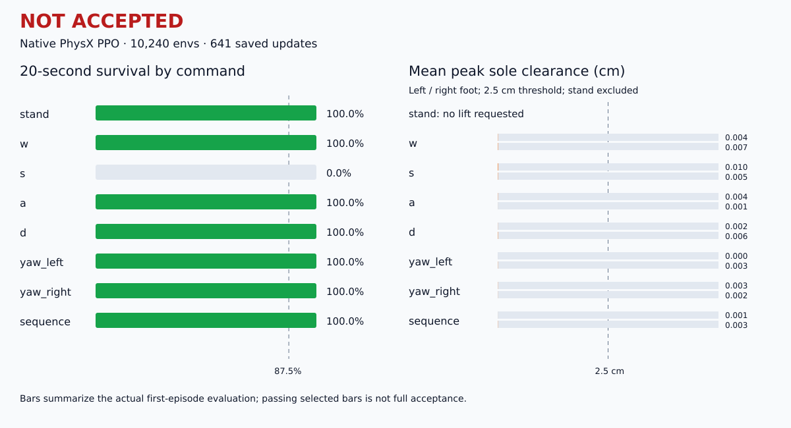

# Q1 Leg URDF · 雙足閃身步

以 BU10 原生雙足 CAD 建立的機器人動作專案，沿用 `q1_wheel_urdf` 的資產目錄與啟動方式。包含 URDF、MediaPipe 前七秒動作映射、Isaac Lab **DirectRLEnv + RSL-RL PPO**、MuJoCo 驗證，以及 Three.js 網頁。


<!-- V4_STATUS_START -->
## V4：鍵盤控制與左右閃身 — 已依早上九點期限結束，尚未通過完整操作驗收

本次使用 **10,240 envs**，已完成 **641／801 iterations**，reward revision **0**。本次接續自 **501 iterations**；最新完整保存進度為 **641 iterations**。 本次啟動：`2026-10-21T00:41:35.185300+00:00`；最後更新：`2026-10-21T00:52:08.415317+00:00`。

依使用者要求，以**台北時間早上 09:00 前結束本次訓練與整理結果**為期限，調整本次更新預算並預留驗證時間。期限到達只代表停止訓練，不代表動作已學會。

最新 32 回合驗證的通過檢查比例為 **44.0%**；這是檢查項目比例，不是任務成功率。

**尚未通過獨立 128 回合確認，因此鍵盤策略保持停用，未發布新版成功 GIF／影片。** 舊版 V3 成果保留於下方。程式碼包含 WASD／QE／Space、有限左右序列、完整 optimizer 續訓、停滯診斷與達標後自動錄影／發布。

```bash
cat outputs/interactive_training_status.json
# 接續剩餘預算，請代入狀態檔的 run 路徑：
bash start_interactive_training.sh --config config/interactive_v4_deadline.json --resume-run /path/to/the/saved/run
```

請參閱 [V4 架構與驗收](docs/V4_ARCHITECTURE.md)。完整原始評估與失敗項目保留在該次 run 中，不能把達到預算或曲線停滯稱作學會動作。

本次限時段實際新增 **140 次完整速度更新**，接續前 501 次，累計 641 次。49 項 Python 檢查通過。原生 32 回合評估顯示，向後仍會跌倒，雙腳離地幾乎為零，尚不具備可靠的方向行走／閃身步。

[完整限時驗收報告](docs/DEADLINE_20261021.md) · [結構化數值結果](docs/results/interactive_v4_deadline_20261021.json)



7.2 秒、seed 42 的原生候選診斷 MP4 與 GIF 已在本機產生，畫面標示 EXPERIMENTAL / NOT ACCEPTED。候選影片及權重仍保留本機，公開診斷影片待另行確認。這個單一未跌倒回合不能代替完整操作驗收。
<!-- V4_STATUS_END -->

## V3 已保存成果

| 項目 | 狀態 |
|---|---|
| 原生模型 | 30 個 mesh 齊全；23 actions／110 observations |
| MediaPipe | 指定影片前 7 秒，306／306 幀有效；20 Hz 原生關節 IK |
| 站立 PPO | 6,144 envs × 8,000 iterations；新種子評估存活 32／32 |
| 閃身步 PPO | 6,144 envs × 8,000 iterations；新種子評估存活 31／32，平均側移幅度 36.6 cm |
| 行走 PPO | 已有實驗，但前進距離未達標；即時入口尚未放行 |
| 抬腳改善 | V3 的獨立微調未執行；本次改以 V4 統一策略重新訓練 |

站立與閃身步皆跑滿 8,000 iterations，再從該次訓練保存的候選中選擇權重。選定站立為 `model_900.pt`，閃身步為 `model_7800.pt`，分別存為 `checkpoints/isaac/<skill>/latest.pt`。這些是原生 CAD 模擬結果，尚未經實機驗證。

V3 閃身步通過的是原有存活、姿態與側移門檻。後續 32 回合診斷發現，右腳平均每回合最高離地僅約 **0.4 cm**，未通過新的雙腳抬腳門檻。這是本次 V4 重新設計抬腳、接觸時序與貼地滑動獎勵的依據。詳見 [抬腳檢查報告](docs/FOOT_LIFT_REVIEW.md)。

[觀看實際 Isaac Sim 閃身步錄影（GoFile）](https://gofile.io/d/020wrR2f) · [專案內 MP4](docs/results/q1_leg_sidestep_6144_8000.mp4)

影片為選定 PPO 權重在 seed 42 的完整 7.78 秒回合，1280×720／50 FPS，該回合未跌倒；單一成功影片不代表所有初始條件都成功。

## 安裝

網頁、MediaPipe 和 CPU 工具使用 Python 3.10 虛擬環境；GPU 訓練另使用 Isaac Sim 自帶的 Python。已驗證環境為 Ubuntu 22.04、Isaac Sim 5.1.0、Isaac Lab 2.3.2、RSL-RL 5.0.1、RTX 4090 Laptop 16 GB。

```bash
git clone https://github.com/willnien10005914/q1_leg_urdf.git
cd q1_leg_urdf

# 需先安裝 uv；GPU 功能另需可用的 Isaac Sim / Isaac Lab。
bash install.sh

# 下載來源片段、用既有 landmarks 重建骨架影片；保留訓練時的關節參考。
bash prepare_motion.sh --videos-only

# 若要重新跑 MediaPipe / IK，請在另一份 checkout 執行：
# bash prepare_motion.sh
# POSE_MODEL=/path/to/pose_landmarker_heavy.task bash prepare_motion.sh
```

參考來源：[YouTube 閃身步示範前七秒](https://youtu.be/KKhF516rSyo)。原始片段與 MediaPipe 模型不納入 Git；處理後的 landmarks、關節參考及來源雜湊已隨程式碼保存。重新擷取後，若要使用選定權重，應保留與其訓練時一致的關節參考；重建新映射可先在另一份 checkout 執行。

`scripts/isaac_env.sh` 自動尋找 `~/IsaacLab` 與 `~/isaacsim/python.sh`。也可設定 `ISAACLAB_PATH`、`ISAAC_PYTHON`、`ISAAC_SIM_PATH` 或 `ISAAC_VENV` 指向本機安裝。

## 網頁：模型與影片並排

```bash
# 同時啟動網頁與背景 Isaac Sim 即時 PPO；使用 systemd user services。
bash start_native_web.sh
```

開啟 **http://127.0.0.1:8876/web/**，選擇站立或閃身步，再切換播放來源。

| 模式 | 行為 | 是否需要背景 Isaac Sim |
|---|---|---|
| 參考動作／關節映射 | MediaPipe 關節動畫 | 否 |
| 即時 PPO／Isaac PhysX | PPO 在 PhysX 中執行，網頁顯示根部與關節狀態 | 是 |
| PPO 物理評估記錄 | 播放先前保存的模擬軌跡 | 否；需先產生記錄 |

網頁 URDF 本身不另外計算重力、摩擦或碰撞。即時模式的物理狀態來自 Isaac Sim；Three.js 的材質、光線與畫面呈現不同。切換動作會重置環境，尚未驗證任意動作間的連續轉換。

右側影片面板可向左拖曳分隔線放大，雙擊還原；支援鍵盤方向鍵、寬度記憶、「放大影片」按鈕，以及原始影片／姿態骨架切換。


不使用 GPU 時，可只啟動網頁；即時模式則以前景程序另開一個終端機：

```bash
bash start_web.sh
# 另一個終端機，需要即時物理時才執行：
bash play_native_web.sh

# 停止背景服務：
systemctl --user stop q1-leg-live q1-leg-web
```

## Isaac Sim 視窗播放與錄影

```bash
# 開啟 Isaac Sim 視窗，重複播放選定 PPO 權重。
bash play_native.sh --skill sidestep
bash play_native.sh --skill stand

# 錄製一個完整閃身步回合；預設 seed 42。
bash record_sidestep.sh
# 明確要求錄完後上傳 GoFile：
UPLOAD_GOFILE=1 bash record_sidestep.sh
```

錄影儲存於 `docs/results/q1_leg_sidestep_6144_8000.mp4`，相鄰 JSON 記錄 checkpoint 雜湊、種子、存活與位移。錄製工具會檢查完整回合及畫面更新，再允許上傳。GoFile 回應檔可能含管理憑證，已排除於 Git。


## 訓練與評估

每個 PPO iteration 收集 24 steps／env，再執行 5 epochs、4 minibatches。6,144 envs 對應每 iteration **147,456 transitions**；每個 8,000-iteration 階段約 11.80 億 transitions。

```bash
# 明確重新執行站立與閃身步各 8000 iterations、6144 envs。
# 站立從已有權重微調，閃身步接續該次通過確認的站立權重。
bash start_large_training.sh

# 查看／停止背景訓練：
systemctl --user status q1-leg-training --no-pager
tail -f outputs/native_curriculum.log
systemctl --user stop q1-leg-training

# 單階段範例：
bash train_native.sh --skill stand --num_envs 512 --max_iterations 1000 --headless

# 比較候選，再以 32 個新種子回合確認：
bash select_policy.sh --skill sidestep --episodes 32

# 僅診斷既有策略的抬腳，不訓練、不替換權重：
bash inspect_foot_lift.sh
```

大型訓練會暫停即時 PhysX 播放以釋放顯存，結束後恢復原本啟動的播放器。站立須通過確認才進入閃身步。完整預算見 [6144／8000 訓練說明](docs/TRAINING_6144_8000.md)；待微調的抬腳設定為 `config/sidestep_foot_lift.json`，不會自動啟動。

原生幾何為預設；可選 `--allow-proxy` 僅供簡化模型回歸實驗，權重不可與原生版本混用。CPU MuJoCo／SB3 另供無 Isaac 的環境檢查，與 RSL-RL checkpoint 格式不互通。

## 資產與目錄

正式來源為使用者提供的 `BU10_robot_Assets-main.zip`。已展開 legged xacro，保留原生關節軸、限位、質量、CoM、慣量與 mesh scale；上游工程占位參數保留於來源 TODO 與 manifest。PhysX 使用來源凸包，MuJoCo 使用同一批 mesh 的凸包衍生檔；原始 STL 不修改。

```text
assets/upstream/bu10_robot_assets/  上游 xacro、STL、工程資料與工具
urdf/q1_inertia/                   原生雙足 URDF
meshes/q1_inertia/                 COMMON / LOWERBODY_LEGGED 原生 mesh
meshes/collision_native/           MuJoCo 凸包衍生幾何
source/leg_humanoid_lab/            Direct RL、FK、動作、獎勵與評估
scripts/reinforcement_learning/    RSL-RL 訓練、播放、錄影與診斷
config/                           資產契約與訓練設定
web/                              離線 Three.js / URDFLoader 網頁
docs/images/                      README 網頁截圖
docs/reference/                   MediaPipe landmarks、關節及抬腳目標
checkpoints/isaac/{stand,sidestep}/ 選定 latest.pt、契約與評估
outputs/                          本機生成的日誌、快取、評估軌跡
```

本版只附站立與閃身步選定權重及其契約／評估，不提交全部模型快照、TensorBoard、模擬快取、來源壓縮包與上傳憑證。公開診斷快照另存於 `docs/results/`。

```bash
# 若要從來源包重新匯入資產：
.venv/bin/python tools/import_assets.py /path/to/BU10_robot_Assets-main.zip
.venv/bin/python tools/build_assets.py --require-native
```

## 驗證與文件

```bash
PYTEST_DISABLE_PLUGIN_AUTOLOAD=1 .venv/bin/python -m pytest -q
.venv/bin/python tests/verify_web.py   # 需啟動網頁與 Chrome
.venv/bin/python tests/verify_live.py  # 另需 Isaac Sim live worker
```

Python 檢查涵蓋原生資產、關節契約、訓練預算與續訓、雙腳抬腳、中途變向、閃身後恢復行走，以及拒絕單腳／滑動／重置造成的假成功。瀏覽器已檢查拖曳放大、鍵盤、寬度記憶、影片切換、WebGL 尺寸與手機版；原生訓練另使用全尺寸場景與新種子動態驗證。

- [架構與控制設計](docs/ARCHITECTURE.md)
- [大型訓練設定](docs/TRAINING_6144_8000.md)
- [播放與錄製](docs/PLAYBACK.md)
- [抬腳診斷及改善準備](docs/FOOT_LIFT_REVIEW.md)
- [第三方來源與授權說明](THIRD_PARTY.md)
