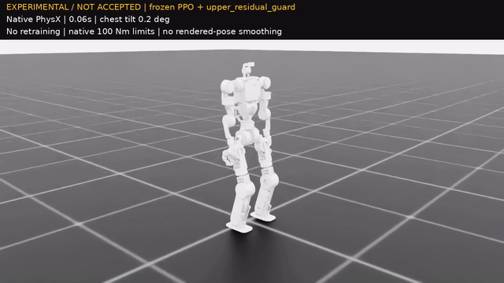
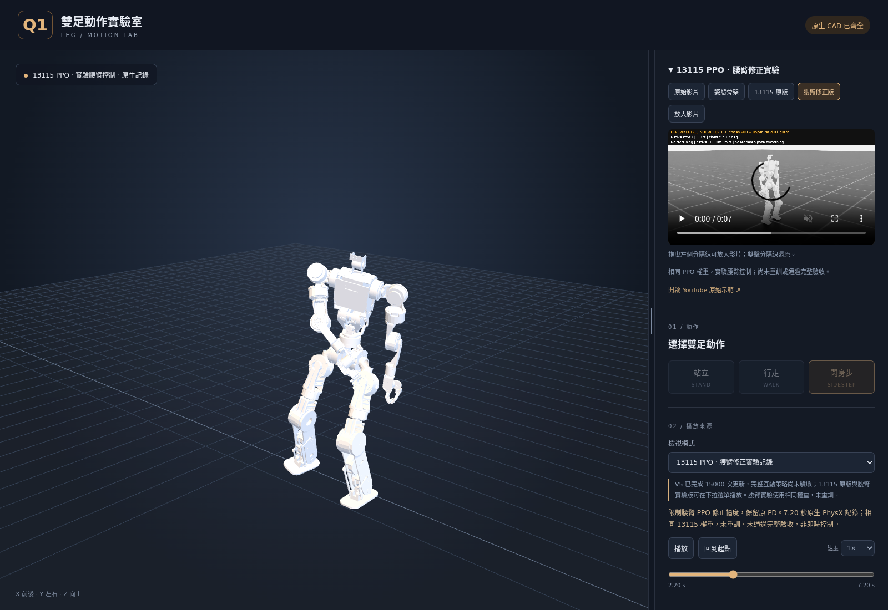
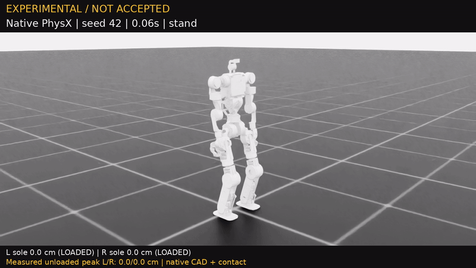
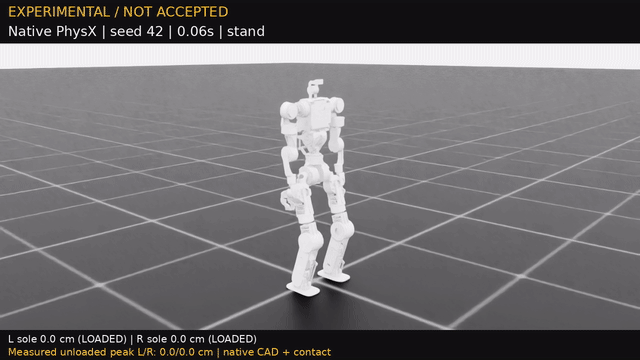
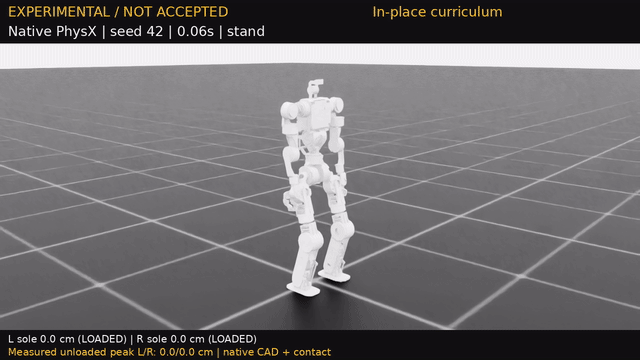
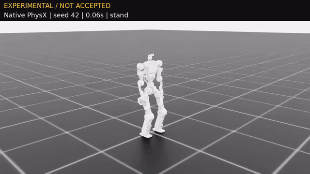
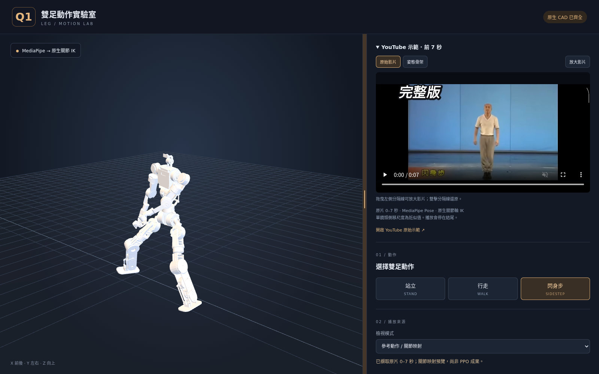
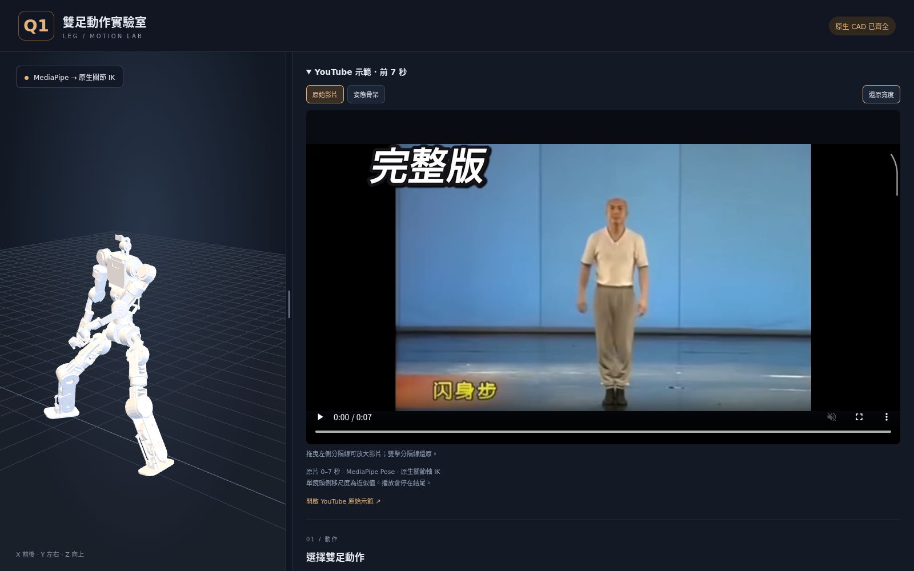
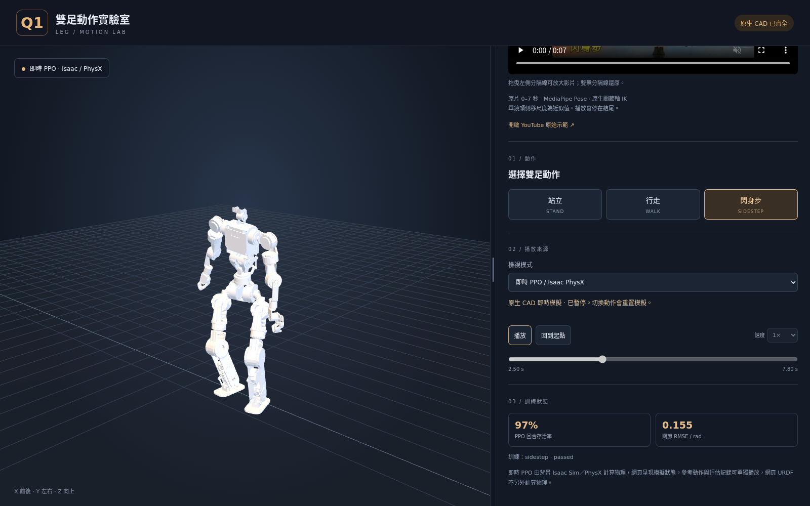

# Q1 Leg URDF · 雙足閃身步

以 BU10 原生雙足 CAD 建立的機器人動作專案，沿用 `q1_wheel_urdf` 的資產目錄與啟動方式。包含 URDF、MediaPipe 前七秒動作映射、Isaac Lab **DirectRLEnv + RSL-RL PPO**、MuJoCo 驗證，以及 Three.js 網頁。

## 2026-10-23：腰臂回位與胸口晃動修正實驗

針對 13115 影片的手臂鬆垂與胸口晃動，保留同一 PPO，限制腰臂修正幅度並維持原 PD。三批原生對照共 **80／80 回合存活 20 秒**；左右連續閃身的胸口峰值平均 **39.0° → 24.2°**，手臂追蹤誤差降低約 **61%**，回站姿雙手距離誤差 **4.9／3.0 cm → 0.9／0.5 cm**。直接加硬 PD 的版本出現提前終止，未採用。**這是物理控制修正實驗，尚未重訓，胸口仍有擺動，也未通過完整鍵盤驗收。**



[新影片（GoFile）](https://gofile.io/d/XMk2RXxH) · [MP4](docs/results/q1_leg_upper_body_13115_experimental.mp4) · [完整對照、逐腳量測與重現指令](docs/UPPER_BODY_13115_REVIEW.md)。單環境新片 7.2 秒、沒有跌倒或重置；胸口峰值 22.4°，左／右閃前導腳卸載峰值 5.67／4.68 cm。



網頁新增「13115 原設定／腰臂修正實驗」原生物理記錄與影片，明示版本及未驗收狀態。`bash start_web.sh` 後開啟 **http://127.0.0.1:8876/web/?source=upper_body** 可直接檢視修正版；不需啟動 Isaac Sim。預設參考動作與舊版獨立 PPO 記錄皆不是新的 V5 即時控制；正式 WASD／QE 仍待完整驗收。

<!-- V5_STATUS_START -->
## V5：已重拍雙腳閃身，完整鍵盤控制仍待驗收

**本輪已於 2026-10-22 台北 17:06 完成 15,000／15,000 次更新並停止（10,240 envs），完整策略仍未驗收通過。** 最後 32／32 回合存活 20 秒，107／109 項檢查通過；剩左轉角速度 RMSE 0.2431 rad/s（上限 0.2000）及左閃機身前進 −0.00291 m（要求至少 +0.01500 m）。未發布正式策略，未做獨立 128 回合確認。[最終結果與保留候選](docs/LIFT_V5_15000_RESULTS.md)。下方影片仍是明確標示版本的 13,115-update 診斷片段。

**2026-10-22 新錄影對應 13,115-update 快照**，使用 **10,240 envs**，15,000 次上限包含先前分支更新。原地抬腳及有限閃身已各通過兩次連續驗收；最新完整評估 **32／32 回合存活 20 秒**，全部閃身相關檢查通過，仍有前進中改向、左移速度及右轉速度三項未達門檻。**尚未通過完整操作與獨立 128 回合確認，正式 WASD／QE 策略仍停用。**



[觀看新左右閃身影片（GoFile）](https://gofile.io/d/jwDWygOO) · [專案 MP4](docs/results/q1_leg_v5_pair_13115_diagnostic.mp4) · [完整評估與逐腳量測](docs/LIFT_V5_13115_DIAGNOSTIC.md)。

新片為同一份 PPO 在原生 PhysX 執行的 **7.20 秒／360 幀**回合：先左閃、再右閃，回穩後回到站立模式，未跌倒、未重置，標示 **EXPERIMENTAL / NOT ACCEPTED**。實際左閃前導／後隨腳卸載峰值 **6.32／7.36 cm**，右閃為 **8.51／7.35 cm**；指定擺腿窗口卸載成功率分別為 **84.6%／100%**、**100%／100%**。這是單一診斷片段，沒有示範完整 WASD／QE 操作；評估的 **106／109 項通過（97.25%）**也不是任務成功率。

該輪後續已完成 15,000 次更新並停止；13,115-update 快照保留作為原版與腰臂修正的比較基準。

### 原始 V5 課程影片（保留作比較）

以下影片記錄使用 **10,240 envs**、累計保存 **1,805 次新 V5 PPO iterations** 的原始分支。後續 V5.1 已建立新控制分支繼續訓練，**15,000 次總上限包含既有 1,805 次，不重新計算預算**。影片均為原生 Isaac Sim／PhysX 執行 PPO，雙腳已有實際離地，沒有固定機身、根部外力或動作間重置。



[觀看左右閃身影片（GoFile）](https://gofile.io/d/ON3DzpRn) · [專案 MP4](docs/results/q1_leg_v5_pair_1805_diagnostic.mp4) · [完整評估與影片量測](docs/LIFT_V5_DIAGNOSTIC.md)。影片為 1,805-update checkpoint、seed 42、7.20 秒／50 FPS，先左閃、再右閃、回到站立；全程標示 **EXPERIMENTAL / NOT ACCEPTED**。

**此原始 1,805-update 候選的有限閃身未通過驗收。** 影片整段最高卸載離地為左 **6.61 cm**、右 **3.69 cm**，但這個最高值不能代表每一次跨步：左腳在左閃時的前導抬腳仍不足 **0.5 cm**，較高的左腳峰值發生於右閃時的後隨抬腳。32 回合評估皆存活 20 秒，當時仍有左右前導腳高度或卸載成功率未達門檻；檢查項目通過比例 **83.6%**，不是任務成功率。

| 已保存候選 | PPO 更新數 | 20 秒第一回合評估 | 階段驗收 | 同候選錄影最高卸載離地 cm（左／右） |
|---|---:|---|---|---:|
| 原地交替抬腳 | 405 | 32／32 存活 | 通過 Stage 0；尚未驗收鍵盤控制 | 7.01／6.73 |
| 有限左右閃身 | 1,805 | 32／32 存活 | 未通過 Stage 1 | 6.61／3.69 |



[觀看原地抬腳影片（GoFile）](https://gofile.io/d/QKZdLPoK) · [專案 MP4](docs/results/q1_leg_v5_inplace_405_diagnostic.mp4) · [原地抬腳評估與量測](docs/LIFT_V5_INPLACE.md)。原地影片為 405-update checkpoint、seed 42、8.00 秒；與 1,805-update 閃身影片使用不同候選，不以其中一支影片替另一候選作驗收。

V5 依序訓練「原地抬腳 → 有限左右閃身 → WASD／QE 與閃身整合」。前兩階段須各連續兩次通過驗收；原始控制分支的 Stage 0 曾在 305、405 updates 通過，後續分支均重新驗收。整合階段仍須連續三次全項通過，再以獨立 **128 回合**確認，才可替換正式策略。**正式 WASD／QE 策略目前保持停用**，新影片不表示完整互動控制已學會。

### 修正與課程紀錄

兩支 V5 診斷影片的控制與訓練來源保存在 [111942c](https://github.com/willnien10005914/q1_leg_urdf/commit/111942c51846537676f816abe4bb7edf0874a7ee)，便於日後修正控制後仍能重現比較。

原生 CAD／FK 與模擬量測一致；左閃前導腳的問題主要來自骨盆側傾約 8 度、下降約 2 cm，以及關節追蹤落差，把幾何參考的離地高度吃掉。縮小支撐腿殘差反而退步；直接加姿態補償 IK，或將補償與速度前饋合用，曾導致腳踝碰地，均未採為新訓練控制。

V5.1 選用原生對照中維持全部回合存活的**閃身擺腿速度前饋**，並以小權重的[左右一致性損失](docs/LIFT_SYMMETRY.md)協助離開單側貼地解；原生左右慣性並不完全對稱，沒有把鏡射資料當作相同物理 transition。分支保留 actor，重新初始化 critic／Adam 與探索 std（0.06），由原地抬腳重新驗收，**不繼承原分支的通過紀錄**。

**2026-10-22 課程紀錄：V5.1b 在 2,215 updates 完成原地課程，後於 2,615 updates 完成有限左右閃身課程，再進入整合訓練。** 前一份 2,010-update 的 32 回合驗證中，站立 16／16 完成，但抬腳 0／16 完成，平均在 13.19 秒提前結束。原生診斷捕捉到停止後右腳踝接地 62–87 N；固定訓練停止相位與驗證不同，是有證據支持的原因之一。新課程讓抬腳持續 3.5–8.5 秒、回合延長至 20 秒，納入不同相位停止及至少 10.8 秒的恢復站立；推論、控制、PD、reward、碰撞終止與驗收門檻不變。[證據與課程修正](docs/diagnostics/LIFT_V5_RECOVERY20_REVIEW.md)。

[2,115-update 獨立原地課程驗證](docs/results/lift_v5_recovery2115_stage0.json)首次通過；[2,215-update 第二次驗證](docs/results/lift_v5_recovery2215_stage0.json)亦通過，兩批合計 **64／64 完整存活 20 秒**。第二批抬腳左右峰值平均 **6.90／7.69 cm**，指定擺腿窗口的卸載成功率 **95.6%／94.8%**，停止後速度約 **0.0041 m/s**。有限閃身後於 2,515、2,615 updates 連續通過驗收；完整鍵盤策略與獨立 128 回合確認仍待完成。

舊分支完整來源與 2,010-update 權重已另行封存，新 run 先新增五次初始化更新後繼續訓練；15,000 上限仍包含所有既有更新。`q1-leg-validation-watchdog` 另行處理超過 300 秒的驗證程序；只重試同一份權重的唯讀驗證，不重跑 PPO 或放寬驗收。`q1-leg-initialization-watchdog` 另檢查超過 600 秒的訓練初始化：必須確認尚未建立 actor、未開始 PPO，並重新核對來源、權重、程序及紀錄，才會終止該次初始化並保留保存點；不會中止已開始學習的程序或自動重排訓練。目前尚未完成完整鍵盤控制驗收；即時更新數與服務狀態請查下列指令。

兩版均使用 implicit PD **800／32**、**100 Nm** 力矩上限。抬腳命令是 **6 cm**，經原生限位與 CAD／FK 得到約 5–6 cm 參考峰值；此為幾何目標，實際結果以接觸感測和腳底量測為準。原始來源與候選均已封存，新分支使用獨立 run。

```bash
# 查詢保存的階段、更新數及驗收結果；不會啟動訓練。
.venv/bin/python tools/run_lift_training.py --status
systemctl --user status q1-leg-lift-training --no-pager
systemctl --user status q1-leg-validation-watchdog --no-pager
systemctl --user status q1-leg-initialization-watchdog --no-pager
tail -n 40 outputs/lift_training.log

# 服務中斷後，接續 V5.1b；來源、profile 及控制契約必須完全一致。
systemctl --user stop q1-leg-live
bash start_lift_training.sh --config config/lift_v5_recovery20.json --resume-run checkpoints/isaac/lift_v5/runs/20261022_0338_recovery20

# 只有來源、控制與資產契約完全一致的 run 才能 resume。
# 修改控制後須建立新 run，不能直接續接原始 1,805-update 診斷 run。
# bash start_lift_training.sh --resume-run /path/to/source-matching/run
```

可使用仍符合其來源契約的本機 checkpoint 重拍。原地與左右序列分開錄製；跌倒立即停止，不重置掩蓋失敗：

```bash
OUT=outputs/v5_inplace_diagnostic.mp4 bash record_interactive_diagnostic.sh --checkpoint /path/to/saved/checkpoint.pt --inplace-only --seed 42
OUT=outputs/v5_pair_diagnostic.mp4 bash record_interactive_diagnostic.sh --checkpoint /path/to/saved/checkpoint.pt --sequence-only --seed 42
```

完整策略合格後，使用[正式錄影入口](docs/LIFT_V5_RECORDING.md)錄製 W 前進、停止、左右各閃一下、恢復站立。工具另行核對每個方向的前導／後隨腳實際卸載離地、逐幀數據及完整畫面；未合格權重不能使用此入口：

```bash
bash record_lift_v5.sh --validate-only
bash record_lift_v5.sh
```

[成果管線](docs/LIFT_V5_FINALIZER.md)可在訓練完整驗收、GPU 空閒後，自動錄影、逐腳驗證、轉 GIF，再按明確的 `--publish` 指令上傳 GoFile、更新 README 並經 SSH 推送。預設不觸網；未合格時只等待，不發布候選權重：

```bash
.venv/bin/python tools/finalize_lift_v5.py --once
# 已授權自動公開影片與 GitHub 更新時：
.venv/bin/python tools/finalize_lift_v5.py --wait --publish
```
<!-- V5_STATUS_END -->

<!-- V4_STATUS_START -->
## V4：限時訓練已結束，候選尚未合格

依 2026-10-21 台北 **09:00 前完成**要求，本次使用 **10,240 envs**，累計保存 **641 iterations**（從 501 次接續；限時上限 801 次，原始上限 15,000 次）。採單一 DirectRLEnv／PPO，WASD／QE、停止與左右閃身共用同一物理狀態。

**目前未通過完整操作驗收與獨立 128 回合確認，不能稱為已學會。** 最新 32 回合通過的檢查項目比例為 **44.0%**，這不是任務成功率。完整結果與各方向抬腳數值見 [限時訓練報告](docs/DEADLINE_20261021.md)。正式鍵盤策略仍保持停用。



上圖是此候選的真實原生 PhysX／PPO 錄影，seed 42、7.20 秒，畫面標有 **EXPERIMENTAL / NOT ACCEPTED**；本回合完成有限序列，仍不能替代整批驗收。[GoFile 診斷影片](https://gofile.io/d/YrpEDE6i) · [專案 MP4](docs/results/q1_leg_interactive_deadline_diagnostic.mp4)。

候選權重僅保留本機，並未取代正式權重。重新錄製時請指定本機保存的 checkpoint：

```bash
OUT=outputs/my_diagnostic.mp4 bash record_interactive_diagnostic.sh --checkpoint /path/to/saved/run/resume.pt --sequence-only --seed 42
bash start_native_web.sh
```

網頁：http://127.0.0.1:8876/web/ 。未合格時仍可檢視 V3 物理預覽與參考動作；新版控制及驗收設計見 [V4 架構](docs/V4_ARCHITECTURE.md)。
<!-- V4_STATUS_END -->

## V3 已保存成果

| 項目 | 狀態 |
|---|---|
| 原生模型 | 30 個 mesh 齊全；23 actions／110 observations |
| MediaPipe | 指定影片前 7 秒，306／306 幀有效；20 Hz 原生關節 IK |
| 站立 PPO | 6,144 envs × 8,000 iterations；新種子評估存活 32／32 |
| 閃身步 PPO | 6,144 envs × 8,000 iterations；新種子評估存活 31／32，平均側移幅度 36.6 cm |
| 行走 PPO | 已有實驗，但前進距離未達標；即時入口尚未放行 |
| 抬腳改善 | V3 的獨立微調未執行；本次改以 V4 統一策略重新訓練 |

站立與閃身步皆跑滿 8,000 iterations，再從該次訓練保存的候選中選擇權重。選定站立為 `model_900.pt`，閃身步為 `model_7800.pt`，分別存為 `checkpoints/isaac/<skill>/latest.pt`。這些是原生 CAD 模擬結果，尚未經實機驗證。

V3 閃身步通過的是原有存活、姿態與側移門檻。後續 32 回合診斷發現，右腳平均每回合最高離地僅約 **0.4 cm**，未通過新的雙腳抬腳門檻。這是本次 V4 重新設計抬腳、接觸時序與貼地滑動獎勵的依據。詳見 [抬腳檢查報告](docs/FOOT_LIFT_REVIEW.md)。

[觀看實際 Isaac Sim 閃身步錄影（GoFile）](https://gofile.io/d/020wrR2f) · [專案內 MP4](docs/results/q1_leg_sidestep_6144_8000.mp4)

影片為選定 PPO 權重在 seed 42 的完整 7.78 秒回合，1280×720／50 FPS，該回合未跌倒；單一成功影片不代表所有初始條件都成功。

## 安裝

網頁、MediaPipe 和 CPU 工具使用 Python 3.10 虛擬環境；GPU 訓練另使用 Isaac Sim 自帶的 Python。已驗證環境為 Ubuntu 22.04、Isaac Sim 5.1.0、Isaac Lab 2.3.2、RSL-RL 5.0.1、RTX 4090 Laptop 16 GB。

```bash
git clone https://github.com/willnien10005914/q1_leg_urdf.git
cd q1_leg_urdf

# 需先安裝 uv；GPU 功能另需可用的 Isaac Sim / Isaac Lab。
bash install.sh

# 下載來源片段、用既有 landmarks 重建骨架影片；保留訓練時的關節參考。
bash prepare_motion.sh --videos-only

# 若要重新跑 MediaPipe / IK，請在另一份 checkout 執行：
# bash prepare_motion.sh
# POSE_MODEL=/path/to/pose_landmarker_heavy.task bash prepare_motion.sh
```

參考來源：[YouTube 閃身步示範前七秒](https://youtu.be/KKhF516rSyo)。原始片段與 MediaPipe 模型不納入 Git；處理後的 landmarks、關節參考及來源雜湊已隨程式碼保存。重新擷取後，若要使用選定權重，應保留與其訓練時一致的關節參考；重建新映射可先在另一份 checkout 執行。

`scripts/isaac_env.sh` 自動尋找 `~/IsaacLab` 與 `~/isaacsim/python.sh`。也可設定 `ISAACLAB_PATH`、`ISAAC_PYTHON`、`ISAAC_SIM_PATH` 或 `ISAAC_VENV` 指向本機安裝。

## 網頁：模型與影片並排



```bash
# 同時啟動網頁與背景 Isaac Sim 即時 PPO；使用 systemd user services。
bash start_native_web.sh
```

開啟 **http://127.0.0.1:8876/web/**，選擇站立或閃身步，再切換播放來源。

| 模式 | 行為 | 是否需要背景 Isaac Sim |
|---|---|---|
| 參考動作／關節映射 | MediaPipe 關節動畫 | 否 |
| 即時 PPO／Isaac PhysX | PPO 在 PhysX 中執行，網頁顯示根部與關節狀態 | 是 |
| PPO 物理評估記錄 | 播放先前保存的模擬軌跡 | 否；需先產生記錄 |

網頁 URDF 本身不另外計算重力、摩擦或碰撞。即時模式的物理狀態來自 Isaac Sim；Three.js 的材質、光線與畫面呈現不同。切換動作會重置環境，尚未驗證任意動作間的連續轉換。

右側影片面板可向左拖曳分隔線放大，雙擊還原；支援鍵盤方向鍵、寬度記憶、「放大影片」按鈕，以及原始影片／姿態骨架切換。



不使用 GPU 時，可只啟動網頁；即時模式則以前景程序另開一個終端機：

```bash
bash start_web.sh
# 另一個終端機，需要即時物理時才執行：
bash play_native_web.sh

# 停止背景服務：
systemctl --user stop q1-leg-live q1-leg-web
```

## Isaac Sim 視窗播放與錄影

```bash
# 開啟 Isaac Sim 視窗，重複播放選定 PPO 權重。
bash play_native.sh --skill sidestep
bash play_native.sh --skill stand

# 錄製一個完整閃身步回合；預設 seed 42。
bash record_sidestep.sh
# 明確要求錄完後上傳 GoFile：
UPLOAD_GOFILE=1 bash record_sidestep.sh
```

錄影儲存於 `docs/results/q1_leg_sidestep_6144_8000.mp4`，相鄰 JSON 記錄 checkpoint 雜湊、種子、存活與位移。錄製工具會檢查完整回合及畫面更新，再允許上傳。GoFile 回應檔可能含管理憑證，已排除於 Git。



## 訓練與評估

每個 PPO iteration 收集 24 steps／env，再執行 5 epochs、4 minibatches。6,144 envs 對應每 iteration **147,456 transitions**；每個 8,000-iteration 階段約 11.80 億 transitions。

```bash
# 明確重新執行站立與閃身步各 8000 iterations、6144 envs。
# 站立從已有權重微調，閃身步接續該次通過確認的站立權重。
bash start_large_training.sh

# 查看／停止背景訓練：
systemctl --user status q1-leg-training --no-pager
tail -f outputs/native_curriculum.log
systemctl --user stop q1-leg-training

# 單階段範例：
bash train_native.sh --skill stand --num_envs 512 --max_iterations 1000 --headless

# 比較候選，再以 32 個新種子回合確認：
bash select_policy.sh --skill sidestep --episodes 32

# 僅診斷既有策略的抬腳，不訓練、不替換權重：
bash inspect_foot_lift.sh
```

大型訓練會暫停即時 PhysX 播放以釋放顯存，結束後恢復原本啟動的播放器。站立須通過確認才進入閃身步。完整預算見 [6144／8000 訓練說明](docs/TRAINING_6144_8000.md)；待微調的抬腳設定為 `config/sidestep_foot_lift.json`，不會自動啟動。

原生幾何為預設；可選 `--allow-proxy` 僅供簡化模型回歸實驗，權重不可與原生版本混用。CPU MuJoCo／SB3 另供無 Isaac 的環境檢查，與 RSL-RL checkpoint 格式不互通。

## 資產與目錄

正式來源為使用者提供的 `BU10_robot_Assets-main.zip`。已展開 legged xacro，保留原生關節軸、限位、質量、CoM、慣量與 mesh scale；上游工程占位參數保留於來源 TODO 與 manifest。PhysX 使用來源凸包，MuJoCo 使用同一批 mesh 的凸包衍生檔；原始 STL 不修改。

```text
assets/upstream/bu10_robot_assets/  上游 xacro、STL、工程資料與工具
urdf/q1_inertia/                   原生雙足 URDF
meshes/q1_inertia/                 COMMON / LOWERBODY_LEGGED 原生 mesh
meshes/collision_native/           MuJoCo 凸包衍生幾何
source/leg_humanoid_lab/            Direct RL、FK、動作、獎勵與評估
scripts/reinforcement_learning/    RSL-RL 訓練、播放、錄影與診斷
config/                           資產契約與訓練設定
web/                              離線 Three.js / URDFLoader 網頁
docs/images/                      README 網頁截圖
docs/reference/                   MediaPipe landmarks、關節及抬腳目標
checkpoints/isaac/{stand,sidestep}/ 選定 latest.pt、契約與評估
outputs/                          本機生成的日誌、快取、評估軌跡
```

本版只附站立與閃身步選定權重及其契約／評估，不提交全部模型快照、TensorBoard、模擬快取、來源壓縮包與上傳憑證。公開診斷快照另存於 `docs/results/`。

```bash
# 若要從來源包重新匯入資產：
.venv/bin/python tools/import_assets.py /path/to/BU10_robot_Assets-main.zip
.venv/bin/python tools/build_assets.py --require-native
```

## 驗證與文件

```bash
PYTEST_DISABLE_PLUGIN_AUTOLOAD=1 .venv/bin/python -m pytest -q
.venv/bin/python tests/verify_web.py   # 需啟動網頁與 Chrome
.venv/bin/python tests/verify_live.py  # 另需 Isaac Sim live worker
```

Python 檢查涵蓋原生資產、關節契約、訓練預算與續訓、雙腳抬腳、中途變向、閃身後恢復行走，以及拒絕單腳／滑動／重置造成的假成功。瀏覽器已檢查拖曳放大、鍵盤、寬度記憶、影片切換、WebGL 尺寸與手機版；原生訓練另使用全尺寸場景與新種子動態驗證。

- [V5 有限閃身診斷與新影片](docs/LIFT_V5_DIAGNOSTIC.md)
- [V5 原地抬腳階段結果](docs/LIFT_V5_INPLACE.md)
- [架構與控制設計](docs/ARCHITECTURE.md)
- [大型訓練設定](docs/TRAINING_6144_8000.md)
- [播放與錄製](docs/PLAYBACK.md)
- [抬腳診斷及改善準備](docs/FOOT_LIFT_REVIEW.md)
- [第三方來源與授權說明](THIRD_PARTY.md)
