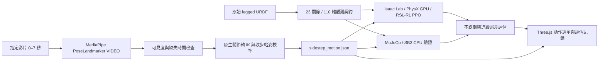

# Q1 雙足架構與訓練課程

沿用 `q1_wheel_urdf` 的目錄、離線 Three.js / URDFLoader、Isaac runtime discovery 與 RSL-RL 相容層；雙足任務獨立實作，沒有沿用輪子速度控制或輪式權重。

## 為何分階段、共用 PPO 契約

站立並非模仿閃身步的數學前提；可直接用動作參考訓練。不過這份新雙足模型尚無接觸／足底校準，直接獎勵快速側移容易先學會倒向側邊。先站立，再行走，最後閃身步能把失敗原因分開觀察。三階段保持相同關節順序、觀測大小、位置殘差動作、網路大小。後一階段載入前一階段的 actor/critic 權重，重建 optimizer 與迭代計數。

三種動作均在觀測提供 skill one-hot、速度命令、phase 與目標關節。當前是各動作的連續訓練權重；不是已驗證可任意切換的單一多技能策略。未來可以在三種動作均通過門檻後，用混合任務 PPO 保留舊技能。SB3 `.zip` 與 RSL-RL `.pt` 不互通，wheel 的 23 維也不代表關節語意相容。

本次實際執行：站立通過 8/8；行走 8/8 不跌倒但前進量不足，因此保留該分支，另以 `config/sidestep_from_stand.json` 從站立權重直接訓練閃身步。有限動作模仿無需把通用行走列為強制前提。閃身步評估另要求實際側移幅度為影片參考的 0.5–1.5 倍，避免只站穩卻未做出動作也通過。

## 資料與物理假設

- 原始 CAD：`urdf/q1_inertia/quanta_robot_legged.urdf`，原始所有關節、質量、CoM、慣量保持不變。共 29 個可動關節，其中 23 個控制，腕與手指固定／保持零位。
- 正式資產為 `BU10_robot_Assets-main.zip`，包內 xacro 已展開成 legged URDF；30 個 mesh 齊全，存於 `meshes/q1_inertia/COMMON` 與 `meshes/q1_inertia/LOWERBODY_LEGGED`，與 wheel 同樣分層。
- `config/asset_manifest.json` 記錄壓縮包、來源及每個原始 STL 的 SHA-256。原始 CAD 不修改；碰撞使用其凸包，機器人自碰撞關閉。MuJoCo 凸包衍生檔位於 `meshes/collision_native`，用於避開 STL 200k 面數上限，不是箱形替代幾何。
- 足底原生範圍約 x=[−0.09,0.14]、y=[−0.06,0.06]、z=[−0.048,0.022] m。預設骨盆離地高度由真正足底頂點 FK 算得 0.88296m。
- 上游 `TODO.md` 指出腳踝 roll、腳掌和胸部部分慣量仍為來源工程占位值；保留原值與來源說明，未宣稱已經完成硬體參數辨識。
- 可選 `--allow-proxy` 仍可跑 box 幾何回歸測試；正式課程預設是原生 CAD，兩種權重不混用。初期簡化模型的權重／結果已移至 `outputs/initial_training/`。
- 控制頻率 50 Hz、物理頻率 200 Hz。位置目標為 reference + 足踝姿態回授 + 0.20 × action rad，遵守原始關節限位與 100 Nm / 10 rad/s 標示值；這些原檔值尚未經實際馬達驗證。
- 單鏡頭 3D 姿態作為動作先驗。深度、側移公尺尺度及足底接觸不是真值；側移以肩寬 0.30m 估計，地板高度用原生 STL 足底頂點 FK 計算。
- MediaPipe 每幀處理，最低可見度 0.45，覆蓋率至少 65%，不插補超過 0.25 秒的缺失。每 0.05 秒做 IK；原始 world/image landmarks、信心值、來源／模型 SHA-256、overlay 影片都保存。
- IK 在右手座標系下擬合肢段方向、水平足底與小扭轉先驗，再以腳踝距離最小四分位的影格校準到原生 default stance。腰部側彎受原檔 ±0.20 rad 限制。

## 評估與放行

每階段以 8 個獨立回合評估，至少 7/8 存活、平均直立投影 ≥0.94、身高誤差 <0.07m。

行走另外要求平均速度誤差 <0.24m/s、10 秒總位移 >0.5m。閃身步要求關節 RMSE <0.30rad、側移軌跡誤差 <0.18m，包含動作結束後回穩。這是初始工程門檻；實機驗證仍需另外進行。

跌倒條件：骨盆低於 0.56m、直立投影低於 0.65、非足底碰地或非有限值。失敗會保留權重與記錄；不會因為影片播放成功而標成 PPO 通過。網頁可查看失敗的物理記錄，狀態會清楚標示。

## 可重現性與限制

CPU 後端已用 Gymnasium checker、原生軸／質量保持、關節限位／速度、跌倒終止與瀏覽器整合測試驗證。GPU 後端另有原生 CAD 四環境 64 步 smoke report。每次訓練的評估與 scope 記錄在各 checkpoint 目錄；這些記錄才是成功與否的依據。

網頁提供參考動作、實際物理評估記錄、即時 Isaac / PhysX PPO 三種來源。即時單環境程序監聽本機 8877，網頁 8876 轉接狀態與動作命令；只有原生契約、URDF 雜湊、權重雜湊與通過評估相符的策略才可執行。支援暫停、繼續與重播。切換動作會重置模擬，尚不表示學會了動作間的連續轉換；也不會控制實機。

足踝回授只用 projected gravity 與 body angular velocity：pitch / roll + 0.15 × angular rate，修正量限制 ±0.15rad，並遵守左右 pitch 的相反原生軸。它是實際致動關節的低階穩定控制，不施加根部外力或固定骨盆。無回授的初期 PPO 結果與正式 v3 契約分開保存。

行走獎勵另對照 0.9 秒週期的左右支撐相位與實際足底接觸，並抑制偏航角速度。後續行走探索標準差重設為 0.15，閃身步為 0.20，entropy coefficient 降為 0.0001。閃身步另強調關節、側移路徑與速度追蹤；所有動作仍透過真實關節力矩與地面接觸執行。

`select_policy.sh` 比較已保存的 actor/critic 權重，在驗證集選出候選後，再以 32 個回合確認。確認種子預設 20000，可用 `--confirmation-seed` 指定未使用過的種子；歷史保守課程設定為 40000；本版 6144 envs／8000 iterations 課程使用 50000，新抬腳診斷使用 60000。只有通過的新種子確認才提升候選為 `latest.pt`；評估保存權重 SHA-256，即時模擬只接受完全相符的已通過權重，閃身步至少需要 32 個回合。完整課程會在閃身步階段結束時自動確認，其他階段在最後權重未達標時也會比較候選。

目前已完成的大型訓練與選定權重見 [README](../README.md)。左右腳抬腳的新目標、診斷及尚未微調的限制見 [FOOT_LIFT_REVIEW.md](FOOT_LIFT_REVIEW.md)。
