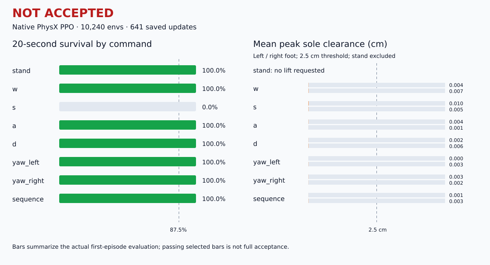

# 2026-10-21 九點期限訓練結果：NOT ACCEPTED / 尚未合格

狀態 `deadline_reached`；實際 **10,240 envs**，保存 **641／801 iterations**。使用者允許依九點期限調整更新預算；停止訓練不代表學會動作。

本表使用 32 回合、seed `71641` 的原生 CAD／PhysX 評估，對應 **641 iterations** 快照。檢查項目通過比例 **44.0%**，不是任務成功率。

| 類別 | 存活 | 正確方向位移 m / yaw rad | 速度 RMSE m/s / yaw rad/s | 雙腳峰值 cm（左／右） | 雙腳抬腳成功率 |
|---|---:|---:|---:|---:|---:|
| stand | 100.0% | 0.000 | 0.000 | 不要求抬腳 | — |
| w | 100.0% | 0.072 | 0.195 | 0.00 / 0.01 | 0.00% / 0.00% |
| s | 0.0% | 0.733 | 0.390 | 0.01 / 0.01 | 0.00% / 0.00% |
| a | 100.0% | 0.097 | 0.174 | 0.00 / 0.00 | 0.00% / 0.00% |
| d | 100.0% | 0.073 | 0.172 | 0.00 / 0.01 | 0.00% / 0.00% |
| yaw_left | 100.0% | 0.371 | 0.588 | 0.00 / 0.00 | 0.00% / 0.00% |
| yaw_right | 100.0% | -0.164 | 0.674 | 0.00 / 0.00 | 0.00% / 0.00% |
| sequence | 100.0% | 0.000 | 0.000 | 0.00 / 0.00 | 0.00% / 0.00% |

抬腳門檻為腳底離地 2.5 cm，且卸載的抬腳成功比例至少 40%；每類存活至少 87.5%。數值為第一回合量測，跌倒後資料不納入。未完整觀測的停止／續走等測量以評估器失敗懲罰值記錄，不能解讀成實際速度。

## 左右閃身細節

| 方向 | 前腳峰值 cm / 成功率 | 後腳峰值 cm / 成功率 | 前腳前／側落點 m | 落腳率 |
|---|---:|---:|---:|---:|
| left | 0.000 / 0.0% | 0.003 / 0.0% | 0.000 / 0.000 | 0.0% |
| right | 0.000 / 0.0% | 0.000 / 0.0% | 0.000 / 0.000 | 0.0% |

## 未通過的檢查

- `w.direction`
- `w.velocity`
- `w.foot_0.clearance`
- `w.foot_0.lift`
- `w.foot_1.clearance`
- `w.foot_1.lift`
- `s.survival`
- `s.stop`
- `s.stance_slip`
- `s.velocity`
- `s.redirection_progress`
- `s.redirection_velocity`
- `s.foot_0.clearance`
- `s.foot_0.lift`
- `s.foot_1.clearance`
- `s.foot_1.lift`
- `a.direction`
- `a.velocity`
- `a.redirection_velocity`
- `a.foot_0.clearance`
- `a.foot_0.lift`
- `a.foot_1.clearance`
- `a.foot_1.lift`
- `d.direction`
- `d.velocity`
- `d.redirection_velocity`
- `d.foot_0.clearance`
- `d.foot_0.lift`
- `d.foot_1.clearance`
- `d.foot_1.lift`
- `yaw_left.yaw_direction`
- `yaw_left.yaw_tracking`
- `yaw_left.foot_0.clearance`
- `yaw_left.foot_0.lift`
- `yaw_left.foot_1.clearance`
- `yaw_left.foot_1.lift`
- `yaw_right.yaw_direction`
- `yaw_right.yaw_tracking`
- `yaw_right.foot_0.clearance`
- `yaw_right.foot_0.lift`
- `yaw_right.foot_1.clearance`
- `yaw_right.foot_1.lift`
- `sequence.resume_progress`
- `sequence.resume_velocity`
- `sequence.left.lead_forward_m`
- `sequence.left.lead_signed_lateral_m`
- `sequence.left.lead_peak_clearance_m`
- `sequence.left.lead_lift_success_rate`
- `sequence.left.trailing_peak_clearance_m`
- `sequence.left.trailing_lift_success_rate`
- `sequence.left.root_forward_m`
- `sequence.left.root_signed_lateral_m`
- `sequence.left.landing`
- `sequence.right.lead_forward_m`
- `sequence.right.lead_signed_lateral_m`
- `sequence.right.lead_peak_clearance_m`
- `sequence.right.lead_lift_success_rate`
- `sequence.right.trailing_peak_clearance_m`
- `sequence.right.trailing_lift_success_rate`
- `sequence.right.root_forward_m`
- `sequence.right.landing`

完整 cases、checks、failed_gates、來源與權重雜湊見 [結構化結果](results/interactive_v4_deadline_20261021.json)。未合格候選的影片僅用於診斷，不能稱為成功示範；本工具不修改權重、驗收 gate 或 README。
