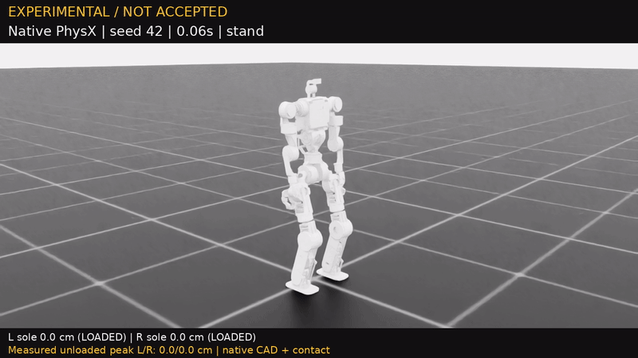

# V5.1b：13,115-update 左右閃身診斷，完整鍵盤控制尚未合格

2026-10-22 重拍。此快照使用 **10,240 envs**，累計保存 **13,115／15,000 次 PPO 更新**；上限包含先前分支的既有更新。原地抬腳及有限閃身課程已各通過兩次連續驗收。最新整合評估 **32／32 回合完整存活 20 秒**，全部閃身相關檢查通過，但仍有三項方向追蹤未達門檻，**尚未完成獨立 128 回合確認，正式 WASD／QE 策略未放行**。

以下為同一份 checkpoint 的原生 Isaac Sim／PhysX 錄影，不固定機身、不施加根部外力，也沒有在動作間重置。



[專案 MP4](results/q1_leg_v5_pair_13115_diagnostic.mp4) · [逐幀錄影量測](results/q1_leg_v5_pair_13115_diagnostic.json)

[觀看這段未正式合格的左右閃身影片（GoFile）](https://gofile.io/d/jwDWygOO)。上傳回應的 MD5 已與本機 MP4 核對；GIF 為此影片的 800 px／12 FPS 衍生預覽。

## 影片實際做了什麼

seed **42**，1280×720／50 FPS，共 **360 幀、7.20 秒**：先站立，減速準備，再左閃、右閃各一下，回穩後回到站立模式。完整錄完、未跌倒、開始後重置 **0 次**，亦未抑制任何自動重置。全程標示 **EXPERIMENTAL / NOT ACCEPTED**。

| 單段錄影量測 | 左腳 | 右腳 |
|---|---:|---:|
| 最高實際卸載離地 | 7.35 cm | 8.51 cm |
| 指定高擺腿窗口卸載抬腳成功率 | 92.0% | 100.0% |
| 指定高擺腿樣本 | 25 | 25 |
| 腳連桿原點最大世界位移 | 19.65 cm | 21.19 cm |
| 腳連桿原點累計世界路徑 | 61.67 cm | 76.29 cm |

最高值本身不能證明每個方向的前導腳都有抬起。依逐幀資料及控制模式分段，本段影片量到：

| 動作／角色 | 實際最高卸載離地 | 指定窗口卸載抬腳成功率 |
|---|---:|---:|
| 左閃：左前導腳 | 6.32 cm | 84.6%（11／13） |
| 左閃：右後隨腳 | 7.36 cm | 100.0%（12／12） |
| 右閃：右前導腳 | 8.51 cm | 100.0%（13／13） |
| 右閃：左後隨腳 | 7.35 cm | 100.0%（12／12） |

分段方法：`mode_changes.time` 是施加控制前的時刻，`foot_observations.time` 是該次物理步完成後的時刻；先以 50 Hz 換算整數步號，將每筆腳部觀測對回 `time − 0.02 s` 的控制模式，再分別計算真正卸載的峰值與高擺腿成功樣本。此為對原始逐幀紀錄的彙整，沒有修改原始量測。

腳底高度使用原生 CAD 腳底最低點；卸載來自物理接觸。高擺腿窗口要求規劃擺腿且參考高度 >2.2 cm；成功要求實際腳底離地 ≥2.5 cm 且卸載。世界位移／路徑包含垂直及水平運動，**不是前進距離**。此影片只示範有限閃身，沒有執行完整 WASD／QE 操作。

## 同 checkpoint 的整合評估

[完整 32 回合評估 JSON](results/lift_v5_13115_stage2.json)。

Stage **2**、seed **384115**，八類各四個回合，只計第一回合；終止及其後的重置姿態不納入。**106／109 項檢查通過（97.25%）**，這是檢查項目比例，不是任務成功率。

| 類別 | 20 秒存活 | 直立指標 | 支撐滑動 RMS m/s | 回合腳底峰值平均 cm（左／右） | 指定窗口卸載抬腳成功率（左／右） |
|---|---:|---:|---:|---:|---:|
| 站立 | 4／4 | 0.9999 | 0.017 | 不要求抬腳 | 不要求抬腳 |
| W 前進 | 4／4 | 0.9992 | 0.063 | 6.24／6.29 | 100.0%／98.9% |
| S 後退 | 4／4 | 0.9993 | 0.059 | 6.84／6.73 | 100.0%／98.9% |
| A 左移 | 4／4 | 0.9993 | 0.059 | 6.08／6.70 | 100.0%／98.9% |
| D 右移 | 4／4 | 0.9994 | 0.063 | 6.62／6.23 | 100.0%／99.4% |
| 左轉 | 4／4 | 0.9993 | 0.060 | 6.16／6.30 | 100.0%／98.9% |
| 右轉 | 4／4 | 0.9994 | 0.052 | 6.56／6.39 | 100.0%／98.9% |
| 閃身及恢復行走序列 | 4／4 | 0.9992 | 0.058 | 7.80／7.72 | 96.0%／97.0% |

評估表的峰值是各回合腳底峰值的平均，不是上方單段影片的最高卸載高度。序列評估另包含閃身前行走、閃身後恢復行走及停止，與 7.2 秒影片的有限閃身時序不同。

序列內左右方向的前導／後隨腳高度、卸載成功、落腳、手部跨向、機身斜前位移、恢復行走與最終停止檢查全部通過：

| 評估方向 | 前導／後隨腳峰值平均 cm | 前導／後隨卸載成功率 | 前導腳落腳率 | 後腳承重且機身前移的推進代理比例 |
|---|---:|---:|---:|---:|
| 左閃 | 6.89／6.90 | 92.3%／100.0% | 100.0% | 48.4% |
| 右閃 | 7.72／7.80 | 94.2%／100.0% | 100.0% | 58.8% |

推進代理使用後腳承重與機身前向速度的同時出現，**不等於直接量到足底切向推力**。閃身後恢復前進位移平均 **0.199 m**，速度 RMSE **0.104 m/s**；最終站立速度平均 **0.0064 m/s**。

## 仍未通過的三項

| 檢查 | 實際數值 | 原驗收上限 |
|---|---:|---:|
| `w.redirection_velocity`：前進途中改向的速度 RMSE | 0.1772 m/s | 0.1600 m/s |
| `a.velocity`：左移速度 RMSE | 0.1213 m/s | 0.1200 m/s |
| `yaw_right.yaw_tracking`：右轉角速度 RMSE | 0.2305 rad/s | 0.2000 rad/s |

沒有為此降低門檻。單段閃身影片及上述方向性改善不能替代完整操作驗收；正式發布仍須整合評估連續三次全過，再通過獨立 128 回合確認。

13,115 之後的下一段訓練在 actor／PPO 更新之前初始化停滯，曾中止並保留這份完整保存的 checkpoint；未完成的下一段不計入更新數。2026-10-22 台北 15:27 已恢復啟動並進入實際 PPO 更新。後續完成數請查 `tools/run_lift_training.py --status`，不要從影片版本推定即時訓練狀態。

## 來源及重現

- 原生機器人：`q1_leg_lift_v5`，23 actions／110 observations。
- 控制：`swing_pitch_002_support_035_imu_020_gesture_velocity_v2`；腿部 implicit PD 剛性／阻尼 800／32，力矩上限 100 Nm。
- 抬腳命令 6 cm；原生限位與 CAD／FK 參考峰值約 5–6 cm。這是幾何目標，實際卸載離地以上述物理量測為準。
- PPO checkpoint SHA256：`b4077ac2a5d3fd98de67e43165cc753263c01d60e33240562303f912e11dbab9`。
- 影片 SHA256：`ced6a72bdf1440fbb8b879a8d4cb5a4a288ac32804c7cce3de5d671f460f9d7a`。
- 原生 URDF SHA256：`2a9a5fce0cd4cf116ba22fcc5c2dfc90747e16c7c1c1ccd0914beec61ce7b3ac`。
- Gait SHA256：`624d0c61630c87d94622ce46eaf2a482b064d0d2461f73533f0eabdd0dc9f137`。
- Control SHA256：`b4e9c6ae242cb28e5d88ed4605b23820667648628fb66dd02702e8295fdd39f4`。

```bash
# 需本機保存的同來源 checkpoint；輸出使用新名稱，保留舊片。
OUT=outputs/v5_pair_13115_repeat.mp4 bash record_interactive_diagnostic.sh --checkpoint /path/to/source-matching/saved/resume.pt --sequence-only --seed 42
```

原始 [405-update 原地影片](LIFT_V5_INPLACE.md)、[1,805-update 閃身影片](LIFT_V5_DIAGNOSTIC.md)及 [V4 未合格影片](DEADLINE_20261021.md)保留作比較。候選權重不隨本診斷影片公開，也不替換正式策略。
