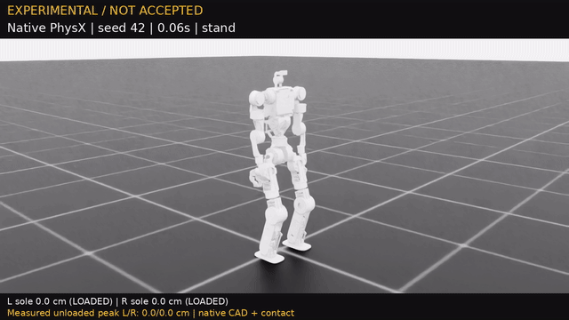

# V5 有限左右閃身診斷：NOT ACCEPTED / 尚未正式驗收

本報告比較**同一份 checkpoint** 的原生 PhysX／PPO 評估與實際錄影，對應 **1,805 次新 V5 PPO 更新**。未通過此階段門檻，仍不能替代 Stage 2 的 WASD／轉向／閃身後續走，以及獨立 128 回合確認。

6 cm 是抬腳命令；經原生關節限位與 CAD／FK 計算後，參考峰值約 5–6 cm。以下數值才是物理模擬中的實際量測，幾何參考不表示 PPO 已學會。全程為原生接觸與關節驅動，不固定機身或施加根部外力。

評估：Stage 1（有限左右閃身）、32 回合；檢查項目通過比例 **83.6%**，這不是任務成功率。只計第一回合，跌倒／重置之後的姿態不納入。

| 類別 | 回合 | 存活 | 直立指標 | 支撐滑動 RMS m/s | 腳底峰值 cm（左／右） | 卸載抬腳成功率（左／右） |
|---|---:|---:|---:|---:|---:|---:|
| 站立 | 8 | 100.0% | 0.999 | 0.014 | 0.00 / 0.00 | 未要求 / 未要求 |
| 左閃身 | 8 | 100.0% | 0.998 | 0.022 | 0.41 / 3.81 | 0.0% / 69.8% |
| 右閃身 | 8 | 100.0% | 0.998 | 0.015 | 6.96 / 2.96 | 91.7% / 33.7% |
| 左右各一下 | 8 | 100.0% | 0.998 | 0.020 | 6.50 / 3.84 | 45.5% / 36.0% |

評估峰值是各回合腳底峰值的平均，與單一錄影的最高卸載高度不同。抬腳成功要求規劃擺腿、參考高度 >2.2 cm、實際離地 ≥2.5 cm 且腳已卸載；支撐滑動使用規劃支撐且承重時的速度。

## 同 checkpoint 實際影片

錄影任務：左閃、右閃各一下，再回穩站立。**7.20 秒／360 幀／50 FPS**；未發生原生回合終止，開始後未重置。畫面標有 `EXPERIMENTAL / NOT ACCEPTED`。

| 腳 | 最高實際卸載離地 cm | 卸載樣本 | 規劃高擺腿樣本 | 實際卸載抬腳成功率 | 世界最大位移 cm | 世界累計路徑 cm |
|---|---:|---:|---:|---:|---:|---:|
| 左腳 | 6.61 | 23 | 25 | 44.0% | 10.18 | 37.77 |
| 右腳 | 3.69 | 44 | 25 | 32.0% | 9.83 | 43.66 |

腳連桿原點相對首個有效影格的最終世界位移 XYZ（cm）：左 (+4.11，-2.20，-0.27)；右 (+5.66，-1.83，-0.23)。世界最大位移／路徑包含水平及垂直運動，不等於向前行走距離。

[觀看這段未合格診斷影片（GoFile）](https://gofile.io/d/ON3DzpRn)。

[專案 MP4](results/q1_leg_v5_pair_1805_diagnostic.mp4) · [影片量測 JSON](results/q1_leg_v5_pair_1805_diagnostic.json)。

## 身分與未通過項目

兩支 V5 診斷影片的控制與訓練來源保存在 [111942c](https://github.com/willnien10005914/q1_leg_urdf/commit/111942c51846537676f816abe4bb7edf0874a7ee)，便於日後修正控制後仍能重現比較。

- 原生機器人：`q1_leg_lift_v5`；控制設定：`swing_pitch_002_support_035_imu_020_v1`。
- Checkpoint SHA256：`2b5ae51154b5db8d8c4043e615b9f7bc9e074cfd41ebdf2e43c99b17ae7cf11e`。
- 原生 URDF SHA256：`2a9a5fce0cd4cf116ba22fcc5c2dfc90747e16c7c1c1ccd0914beec61ce7b3ac`。
- Gait SHA256：`624d0c61630c87d94622ce46eaf2a482b064d0d2461f73533f0eabdd0dc9f137`。
- Control SHA256：`56c8ee1f54b95de75c5e65e90c5c053c9f9424da4b2994ec1b475316e6b559ca`。
- 影片 SHA256：`2271daa11431abc0f28c06487f092d7d65b55efdbb6be2fbe4c90dd5eec1c27a`。

- `left.foot_0.foot_peak_clearance_m_per_foot`
- `left.foot_0.foot_lift_success_rate_per_foot`
- `left.left.lead_peak_clearance_m`
- `left.left.lead_lift_success_rate`
- `right.foot_1.foot_lift_success_rate_per_foot`
- `right.right.lead_lift_success_rate`
- `pair.foot_1.foot_lift_success_rate_per_foot`
- `pair.left.lead_peak_clearance_m`
- `pair.left.lead_lift_success_rate`
- `pair.right.lead_peak_clearance_m`
- `pair.right.lead_lift_success_rate`

本報告只描述這個候選與單段錄影，不發布策略、不改驗收條件，也不將片段視為整批成功證明。

## 前導腳與後隨腳分解

整段峰值包含另一方向的後隨抬腳，不能拿來代表左閃的前導腳已抬起。以下為同一份 32 回合 Stage 1 評估的方向分解；峰值是各回合峰值的平均。

| 評估命令 | 閃身方向 | 前導腳峰值 cm | 前導卸載抬腳成功率 | 後隨腳峰值 cm | 後隨卸載抬腳成功率 |
|---|---|---:|---:|---:|---:|
| 單次左閃 | 左 | 0.41 | 0.0% | 3.81 | 69.8% |
| 單次右閃 | 右 | 2.96 | 33.7% | 6.96 | 91.7% |
| 左右各一下 | 左 | 0.41 | 0.0% | 3.84 | 71.9% |
| 左右各一下 | 右 | 2.27 | 2.9% | 6.50 | 94.8% |

左閃前導腳峰值約 0.41 cm，且卸載抬腳成功率為 0%；因此即使整段左右腳曾離地、全部回合存活，有限閃身仍不合格。
