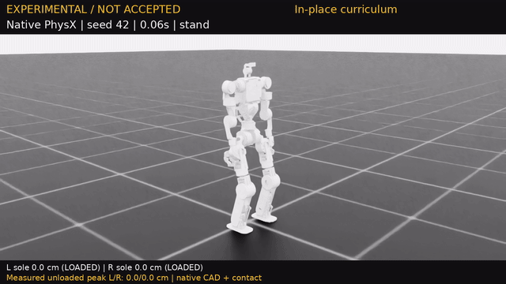

# V5 原地抬腳診斷：NOT ACCEPTED / 尚未正式驗收

本報告比較**同一份 checkpoint** 的原生 PhysX／PPO 評估與實際錄影，對應 **405 次新 V5 PPO 更新**。通過此階段門檻，仍不能替代 Stage 2 的 WASD／轉向／閃身後續走，以及獨立 128 回合確認。

6 cm 是抬腳命令；經原生關節限位與 CAD／FK 計算後，參考峰值約 5–6 cm。以下數值才是物理模擬中的實際量測，幾何參考不表示 PPO 已學會。全程為原生接觸與關節驅動，不固定機身或施加根部外力。

評估：Stage 0（原地抬腳）、32 回合；檢查項目通過比例 **100.0%**，這不是任務成功率。只計第一回合，跌倒／重置之後的姿態不納入。

| 類別 | 回合 | 存活 | 直立指標 | 支撐滑動 RMS m/s | 腳底峰值 cm（左／右） | 卸載抬腳成功率（左／右） |
|---|---:|---:|---:|---:|---:|---:|
| 站立 | 16 | 100.0% | 0.999 | 0.015 | 0.00 / 0.00 | 未要求 / 未要求 |
| 原地抬腳 | 16 | 100.0% | 0.999 | 0.037 | 7.02 / 6.65 | 100.0% / 95.1% |

評估峰值是各回合腳底峰值的平均，與單一錄影的最高卸載高度不同。抬腳成功要求規劃擺腿、參考高度 >2.2 cm、實際離地 ≥2.5 cm 且腳已卸載；支撐滑動使用規劃支撐且承重時的速度。

## 同 checkpoint 實際影片

錄影任務：原地抬腳課程，不是鍵盤行走測試。**8.00 秒／400 幀／50 FPS**；未發生原生回合終止，開始後未重置。畫面標有 `EXPERIMENTAL / NOT ACCEPTED`。

| 腳 | 最高實際卸載離地 cm | 卸載樣本 | 規劃高擺腿樣本 | 實際卸載抬腳成功率 | 世界最大位移 cm | 世界累計路徑 cm |
|---|---:|---:|---:|---:|---:|---:|
| 左腳 | 7.01 | 97 | 50 | 100.0% | 23.51 | 115.58 |
| 右腳 | 6.73 | 91 | 55 | 92.7% | 15.10 | 99.10 |

腳連桿原點相對首個有效影格的最終世界位移 XYZ（cm）：左 (+14.59，+10.75，-0.26)；右 (+9.18，+11.62，-0.07)。世界最大位移／路徑包含水平及垂直運動，不等於向前行走距離。

[觀看這段未合格診斷影片（GoFile）](https://gofile.io/d/QKZdLPoK)。

[專案 MP4](results/q1_leg_v5_inplace_405_diagnostic.mp4) · [影片量測 JSON](results/q1_leg_v5_inplace_405_diagnostic.json)。

## 身分與未通過項目

兩支 V5 診斷影片的控制與訓練來源保存在 [111942c](https://github.com/willnien10005914/q1_leg_urdf/commit/111942c51846537676f816abe4bb7edf0874a7ee)，便於日後修正控制後仍能重現比較。

- 原生機器人：`q1_leg_lift_v5`；控制設定：`swing_pitch_002_support_035_imu_020_v1`。
- Checkpoint SHA256：`1204b93acd2c422d78192be70898bf632033fb1316057dc54aaea8ea7abbb8ce`。
- 原生 URDF SHA256：`2a9a5fce0cd4cf116ba22fcc5c2dfc90747e16c7c1c1ccd0914beec61ce7b3ac`。
- Gait SHA256：`624d0c61630c87d94622ce46eaf2a482b064d0d2461f73533f0eabdd0dc9f137`。
- Control SHA256：`56c8ee1f54b95de75c5e65e90c5c053c9f9424da4b2994ec1b475316e6b559ca`。
- 影片 SHA256：`f636f30427c0ca8973dc7da77bcd6e8ae9445faa3c4fd014f36e910ee3038bf1`。

本階段沒有未通過項目；正式整合操作仍須另行驗收。

本報告只描述這個候選與單段錄影，不發布策略、不改驗收條件，也不將片段視為整批成功證明。
