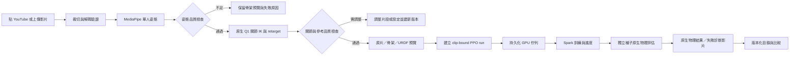

# Q1 Motion Store：影片到 PPO 的產品與架構規劃

> 狀態：設計文件，尚未實作 Store、影片上傳 API、通用影片模仿環境或網站部署。
> 本文件不表示現有網頁已能接收影片並自動訓練。Spark 平衡訓練與此規劃分開執行。

## 參考來源與本專案範圍

使用者指定參考：[Unitree UniStore](https://unistore.unitree.com/)。官方[動作庫](https://unistore.unitree.com/actions)有動作搜尋及篩選，導覽包含使用者廣場、動作庫、資料集、訊息及開發者中心。

官方[建立動作手冊](https://unistore.unitree.com/manuals?slug=create-application)將動作身分與具體版本分開，動作資料包括識別碼、名稱、分類、支援機型、圖示、封面和預覽影片。官方[版本手冊](https://unistore.unitree.com/manuals?slug=upload-action-version)說明版本號、更新說明、程式包、執行環境及審核／上架／下架流程。

本專案採用其「可搜尋動作目錄＋固定動作身分＋可持續增加版本」的組織方式。下面的 YouTube／上傳影片 → MediaPipe → Spark PPO → 進度與結果影片，是本專案提出的新功能；沒有證據表示 UniStore 已提供這條流程。不複製或聲稱已重現其實際畫面。

## 使用流程

建立流程分兩個明確操作：「建立並預覽動作」先完成 CPU 姿態與 IK；「加入訓練佇列」再建立有資源預算的 PPO run。失敗不自動重排、不覆蓋舊版本；使用者能查看原因、改參數建立新版本。

## 畫面與資訊架構

| 畫面 | 主要內容與操作 |
|---|---|
| 動作庫 | 搜尋、分類、機型、引擎、驗收狀態篩選；卡片顯示縮圖、動作名、標籤、版本、影片、實驗／合格標示 |
| 建立動作 | YouTube／檔案來源、裁片時間、標題、分類、Q1 機型；顯示預計處理範圍 |
| 動作詳情 | 頁籤：概覽與影片、來源與骨架、Retarget、訓練進度、評估報告、版本 |
| 影片與模型比較 | 原片、骨架、retarget URDF、PPO 物理影片切換；可比較兩個 run；各自標示版本與物理／幾何來源 |
| 訓練工作 | 排隊位置、階段、heartbeat、保存的更新數、訓練速率、評估曲線、終止原因與產物連結 |
| 版本管理 | 固定動作 ID、版本號、更新說明、初始化來源、來源契約、公開／下架；舊證據保留 |

預覽影片不作為 PPO 成功證據。`completed` 表示工作完成，`accepted` 必須來自特定機型、控制契約和原生物理評估。診斷影片可以保存在目錄，但標示 `experimental` 或 `failed_gate`；公開展示與允許即時控制是兩項獨立決定。

## 現有程式如何銜接

- [web/serve.py](../web/serve.py) 是唯讀檢視伺服器，另有既有 live command proxy。保留其網址和行為，不把上傳、解碼或 PPO 阻塞工作塞入請求執行緒。
- [web/app.js](../web/app.js) 已有原片／骨架／URDF／物理記錄呈現與 5 秒狀態輪詢，可抽出成動作詳情播放器。
- [tools/extract_sidestep.py](../tools/extract_sidestep.py) 可重用 MediaPipe 和 `retarget()` IK；目前硬編碼前 7 秒、來源網址、sidestep 輸出檔名、20 Hz 及肩寬尺度假設，需先參數化，輸出至每個版本獨立目錄。
- [tools/build_v5_gaits.py](../tools/build_v5_gaits.py) 是程序化步態／閃身參考，不是通用影片模仿環境。
- [tools/run_spark_balance.py](../tools/run_spark_balance.py) 提供本輪平衡訓練進度、凍結來源、實際更新數與 GPU 鎖，可作第一個既有 run adapter。

**通用 imitation 仍需另外實作。** 現有 V7 110 維 observation、固定 gait table、閃身命令和驗收條件綁定目前任務，不能只換影片 JSON 就宣稱支援任意動作。規劃新增 clip-bound environment：每份 run 明確綁定 reference、相位、控制／觀測及任務驗收契約，從經核實的 checkpoint 初始化或另訓新 PPO。第一版先限制可辨識的站立／行走／有限閃身類；超出範圍的影片可保留預覽，不能直接排入同一訓練器。

## 儲存與資料實體

第一版使用本機磁碟與 SQLite，不先引入雲端服務。SQLite 開啟 foreign keys、交易與 WAL；一個排程程序負責 job 狀態轉移。二進位產物依 SHA256 儲存在 `store/objects/<prefix>/<sha256>`，metadata 只保存 object ID 與已驗證類型。`store/` 是規劃路徑，尚未建立；產物不進 Git。

| 實體 | 主要欄位／關係 |
|---|---|
| `motions` | UUID、不可變 slug、名稱、描述、分類、owner、robot、目前公開 version ID |
| `motion_versions` | motion ID、唯一 version、parent version、更新說明、建立時間、visibility、publication status |
| `source_assets` | source type、canonical YouTube ID／原檔名、video hash、裁片起訖、codec／fps／尺寸 |
| `retargets` | version ID、source ID、landmarks／reference object IDs、品質報告、retarget contract hash |
| `training_runs` | UUID、retarget ID、parent run／bootstrap、config hash、source snapshot、backend、預算／完成數、state、heartbeat |
| `evaluations` | run／checkpoint hash、case、seed、episodes、門檻版本、原始報告、passed／failed |
| `artifacts` | object hash、type、bytes、producer job、visibility；原片／骨架／軌跡／checkpoint／結果影片各自記錄 |
| `jobs`、`job_events` | queue position、依賴、worker lease、attempt、stage、進度、事件序號、失敗原因與時間 |

同一動作可有多個 retarget 和訓練版本。既有 object 和已發布版本不可原地覆寫；更改片段、控制、模型或引擎建立新版本／run。下架只改公開索引，舊測試證據及 lineage 不刪除。原片預設 private，對外顯示的影片由明確 artifact 權限決定。

## 不可變來源與模型契約

每個 run 保存 `manifest.json`、設定、Git commit 與必要來源 snapshot，至少記錄：

| 範圍 | 契約欄位 |
|---|---|
| 原片與姿態 | canonical URL／ID、影片 hash、裁片起訖、MediaPipe model hash／版本、timestamps、visibility／presence、coverage、max gap |
| Retarget | IK／濾波／重採樣設定、尺度與相機假設、joint order、URDF／mesh／慣量 hash、限位、reference／contact target hash |
| 訓練 | observation／action／控制／reward contract、PD／速度／扭矩、bootstrap hash、optimizer lineage、seed、envs、每輪 steps、總預算、實際完成數 |
| 執行環境 | backend、Isaac Lab／Sim 或 Newton 版本與 commit、PyTorch／RSL-RL、CUDA／driver、機器架構 |
| 結果 | checkpoint hash、原生評估 cases／seeds／門檻版本、首次終止事件、結果影片與 frame metadata hash |

變更 backend 或 observation 不能直接當作相同實驗續訓。幾何參考、訓練結果、原生診斷及真機驗證分別標示，不能用其中一種替代另一種。

## 工作狀態與 GPU 排程

Asset 狀態：`ingesting → extracting_pose → pose_qc → retargeting → retarget_qc → preview_ready`。

Run 狀態：`queued → preparing → training → evaluating → rendering → completed`；旁支包括 `failed`、`cancelled`、`needs_review`。驗收結果另設 `unverified`、`candidate`、`accepted`、`failed_gate`。例如 `completed + failed_gate` 是完成預算但未學會；仍可產生失敗診斷影片。

CPU pose／IK workers 與 GPU PPO workers 分離。新 PPO jobs 必須使用與本輪 supervisor 相同的 `~/will/.spark-training-gpu.lock`，不可另開獨立鎖而同時啟動第二個大型 PPO。鎖是合作程序間的互斥機制，還需核對 GPU 程序；不任意停止既有 viewer 或其他專案。排程服務取得鎖後，才交給具體訓練 supervisor 管理 worker。queue 不直接包住另一個已會取相同鎖的 supervisor，以免自我 deadlock。

固定預算隨 run 凍結。中斷後先對帳保存 checkpoint／實際執行更新；不能以最後一份安全保存數據為理由，自動重跑可能已花費但未落盤的 updates。取消保留 checkpoint、log 和事件，不把使用者停止顯示為完成。

## API 草案

以下端點僅為設計，尚未提供：

| 端點 | 用途 |
|---|---|
| `GET /api/store/motions?query=&robot=&status=&page=` | 分頁搜尋動作目錄 |
| `POST /api/store/motions` | 建立固定動作身分 |
| `GET /api/store/motions/{id}` | 詳情、版本與公開產物 |
| `POST /api/store/motions/{id}/versions` | 新版本與來源設定 |
| `POST /api/store/uploads` | 受限串流上傳；回 asset ID，不接受本機任意路徑 |
| `POST /api/store/ingest/youtube` | 驗證 canonical YouTube 來源並建立 CPU ingest job |
| `POST /api/store/versions/{id}/retargets` | 以固定設定產生姿態／IK job |
| `POST /api/store/retargets/{id}/runs` | 品質合格後，以固定預算排新 PPO run |
| `GET /api/store/runs/{id}` | 階段、保存進度、heartbeat、評估與影片 |
| `GET /api/store/runs/{id}/events?after=` | 增量事件；第一版 polling，後續可加 SSE |
| `POST /api/store/runs/{id}/cancel` | 停止指定 run，保留可審查產物 |
| `GET /api/store/artifacts/{id}` | 經權限及類型檢查的串流／Range 影片 |
| `POST /api/store/versions/{id}/publication` | 明確上架／下架；不自動授予 live controller 權限 |

客戶端不能提供 shell、啟動 script、任意 backend Python 路徑或 checkpoint 本機路徑。建立 job 使用 idempotency key，避免重按造成兩份昂貴訓練。對外開放時才新增相應登入、擁有者權限與來源保護；第一版仍保持 localhost。

## 第一個可交付功能：現有 Spark run 的唯讀進度

先將本輪 6,144 envs／15,000 新更新的 run 顯示在目錄，尚不新增 ingest 或訓練操作。

1. Adapter 讀取本機 `outputs/spark_balance_status.json`；run 詳情以 supervisor 指向的 `status.json` 及 `events.jsonl` 對帳。檔案未建立顯示 `not_started`，無 heartbeat 顯示資料過期，不假裝正在訓練。
2. 顯示 `state`、`updated_at`、`num_envs`、`max_new_iterations`、`completed_iterations`／`saved_iterations`、`worker_log_iteration`、`latest_steps_per_second`、`transitions`、`latest_evaluation` 和來源 commit。
3. 圖表以已提交 checkpoint 的完成數當主進度；log iteration 是即時估計，另外標示。ETA 根據近期 worker 時間估算，清楚保留初始化／評估成本的不確定性。
4. 顯示每方向四步完整率、存活率、首次接觸失敗及足底卸載；缺少數據用「尚未評估」，不用 0 代替。`accepted=false` 保持可見。
5. 以 artifact ID 提供已產生的原生影片；尚未錄影顯示待產生，不拿舊 x86 影片冒充本輪結果。日誌先提供經挑選欄位，不直接把整個 `outputs/`、checkpoint tree 或任意本機路徑公開。
6. 新 Store view 保持與現有 `/web/`、`/api/status`、live proxy 相容；本階段不操作正在訓練的凍結來源。

驗收：status 不存在／更新中／過期／training／evaluating／failed／budget exhausted 均顯示正確；15,000 只是預算進度，不會自動顯示「已學會」。原先播放器與控制入口仍可按原方式使用。

## 後續交付階段

| 階段 | 範圍 | 完成條件 |
|---|---|---|
| A | 唯讀 Store、現有 Spark run adapter、版本詳情 | 第一個交付如上；沒有假的上傳或訓練按鈕 |
| B | YouTube／upload、CPU pose、品質檢查與 retarget 預覽 | 每份來源有獨立目錄與 hash；低品質與超限輸入能明確失敗；既有 sidestep 資產未被覆蓋 |
| C | clip-bound imitation environment、PPO queue、進度與原生影片 | 新 reference 契約成立；小規模 smoke／resume 與目標 envs 驗證；失敗不發布合格模型 |
| D | 比較／分類／發布管理、更多機型及引擎驗證 | 固定 version URL；版本 lineage 可追溯；每機型／backend 各自驗收，不借用其他引擎成績 |

多動作 conditioned PPO、對外多人服務與真機部署是後續範圍，不能包含在目前單一閃身平衡訓練的已完成功能中。

## 影片輸入與品質界線

首版建議可配置限制：最大 200 MB、選定片段 3–30 秒，解碼上限例如 1080p／30 FPS；按實際解碼的尺寸、幀數、時長與 worker 時間限制資源，而非只信副檔名或客戶端 metadata。

YouTube 僅接受辨識後的 `youtube.com`／`youtu.be` video ID，建立 canonical URL，透過 `yt-dlp` 的 argv 執行；拒絕任意 URL、本機檔案 URL、私人網段跳轉和 shell。上傳採 server-generated ID 與受限目錄，實際解碼驗證格式；解碼及下載 worker 設 timeout，錯誤保留可讀原因。原片不直接納入既有靜態路由的公開範圍。

MediaPipe 單人單鏡頭是近似動作先驗：遮擋、快速轉身、景深、視角、左右辨識和人體／Q1 比例差異會造成誤差。無標定的 root 位移／深度不能當作真實尺度；站姿校正及水平足底假設也不適合所有舞蹈或跳躍。品質報告需包含 coverage、最大斷點、關節限位／速度、IK 誤差、足底幾何與前後姿態連續性。可視化預覽、物理可行性與真機可靠性各自保留證據。
