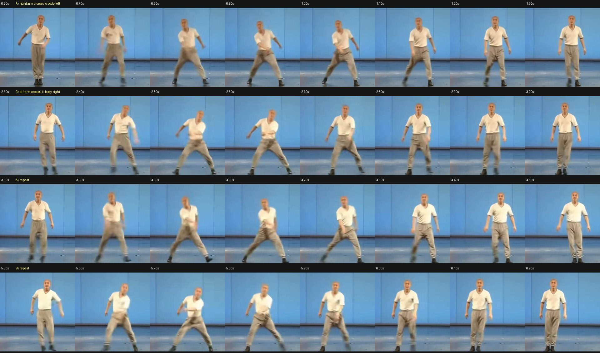

# V4 閃身步：原片觀察與機器人動作規格

本次重新觀看 [原片](https://youtu.be/KKhF516rSyo) 的前七秒，並以本機 `sidestep_0_7.mp4` 每 0.1 秒抽幀，對照同片 MediaPipe landmarks。以下先記錄影片可確認的事實，再列出配合使用者要求的機器人設計目標；設計目標尚不代表 PPO 已學會。

## 影片可確認的時序

片長 7.0 秒，影像為 1280×576、約 43.612 FPS，306 幀有 MediaPipe 結果。人物面向鏡頭，因此**人物左側是畫面右側**；以下左右都以人物／機器人自身為準。

| 片段 | 可見展步至收步 | 踝關節影像水平間距最大時間 | 配合的手部動作 |
|---|---|---|---|
| A1 | 約 0.65–1.35 s | 0.917 s | 右手向身體左前方橫掃，左腳向自身左側展開，右腳之後靠攏 |
| B1 | 約 2.30–2.95 s | 2.545 s | 左手向身體右前方橫掃，右腳向自身右側展開，左腳之後靠攏 |
| A2 | 約 3.85–4.50 s | 4.127 s | 重複 A1 的方向 |
| B2 | 約 5.50–6.15 s | 5.755 s | 重複 B1 的方向 |

四次展步最大值間距為 1.628、1.582、1.628 秒，平均約 1.61 秒；其中包含收步與短暫站立。動作不是持續走路：每個 burst 都有窄站姿、快速展步與手部橫掃、收步、短暫站定。手部主要從軀幹前方斜向橫掃，最高位置接近腰腹至下胸，不宜解讀成高舉手臂。第二、第四次應以第一個方向做左右鏡像。

影像中展步常包含兩腳快速改變間距；不能將每次 burst 直接當成十六個已被影片證實的獨立步伐。舊版 `sidestep_foot_targets.json` 的十六個順序抬腳，是方便訓練的規劃結果，並不是原片的逐次接觸標註。新版有限動作應明確執行左、右各一次。

## 單鏡頭不能證明的部分

- 原片正面且動作有模糊，無力板、相機內外參、地面標定或第二視角。MediaPipe 的三維深度不能用來斷言腳向前／向後的公分數、足底法向力或推蹬脈衝。
- 腳尖接近影像下緣；部分後段腳尖 landmarks 的影像 `y` 大於 1，已超出有效畫面。全片都有 pose 結果，不等於每個腳部點都有足夠精度；四段局部最低整體 confidence 約為 0.867、0.679、0.472、0.584。
- 可見低幅度離地／收步及軀幹側移，但不能可靠量出「人類實際抬腳 4 公分」、精確觸地順序或短暫雙腳同時離地。機器人應透過自身幾何與 PhysX 接觸資料驗證這些量。

因此，**左腳往左前踏、右腳向右後定位推蹬，反方向鏡像**是使用者要求且物理上合理的機器人目標，不宣稱是單鏡頭已重建出的精確人類地面軌跡。

## 機器人座標與有限動作

採機器人軀幹座標 `+X` 向前、`+Y` 向左、`+Z` 向上。A 方向為左前，右手跨身；B 方向為右前，左手跨身。對關節參考做鏡像時，應按原生 URDF 的關節軸及左右對應轉換，不能對所有右側角度統一取負。以腳尖、手腕的前向運動學結果確認鏡像方向。

建議每側約 1.0–1.2 秒；先用可控制的低幅度動作學會交替接觸，再縮短時間接近影片。以下是建議的規劃，不是已量到的原片接觸時序。

| 單側相位 | 約占時間 | 左前 A 的目標；B 完整鏡像 |
|---|---:|---|
| 預備與卸載 | 0–15% | 右腳支撐，左腳卸載；右手開始跨向左前 |
| 前腳擺動與後腳推蹬 | 15–45% | 左腳微抬向左前；右腳接觸地面產生向左前的身體推進，右手橫掃 |
| 前腳落地承重 | 45–60% | 左腳落地後確認接觸，再逐漸承重；避免把腳剛接近地面當成已支撐 |
| 後腳收步 | 60–85% | 右腳完成推蹬後才微抬回收，縮小站距 |
| 雙足站定 | 85–100% | 雙足接觸、手臂回中立、速度下降，準備鏡像方向 |

「後腳微抬」和「頂地推身」要先後發生：腳仍接觸地面時才能推蹬；卸載抬起後不可能再從地面取得推力。不可用獎勵同時要求同一隻腳飛行且提供地面推力。

初始量級可採前腳相對目前腳位 `ΔX=+0.06…0.10 m`、`ΔY=+0.08…0.14 m`、離地峰值 `0.03…0.04 m`；後腳以原支點或很小的後側定位支撐，推蹬後回收峰值 `0.02…0.03 m`。這些是安全可學習的起始範圍，需按 native CAD、關節限制、碰撞與模擬穩定度調整，不能直接當作量測值或已達成結果。

使用者點一次按鈕後，事件鎖定為 **A → B → 站立**，各一次且不循環。左右各一次可使側向位移大致抵消，但兩次都是「前」踏，世界座標的前進量不一定抵消；不要為了回到原點而強制第二次退後。動作結束後才重新接受鍵盤行走命令，並清除進入動作前殘留的按鍵狀態。停止／緊急停止必須能覆蓋事件鎖定。

## 驗證方向

除了存活與外觀，必須分開記錄：兩腳的 native sole 最低點高度、感測接觸力、支撐腳速度、腳的機器人座標落點、身體在指定方向的位移、跨身手掌／gripper 原點的機器人座標位置，以及 A/B 完成次數。最低足底高度應由原生 CAD 支撐頂點與腳的實際旋轉求得，不能用腳 body 原點的高度代替。腕關節位於手掌後方，跨身判準使用 gripper 原點。

詳細的使用者流程、量化門檻與早停條件另見 [V4_ACCEPTANCE.md](V4_ACCEPTANCE.md)。通過驗證前，舊版影片、GIF 及評估仍只代表舊權重，不作為新版成果。
