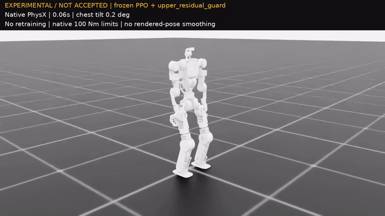
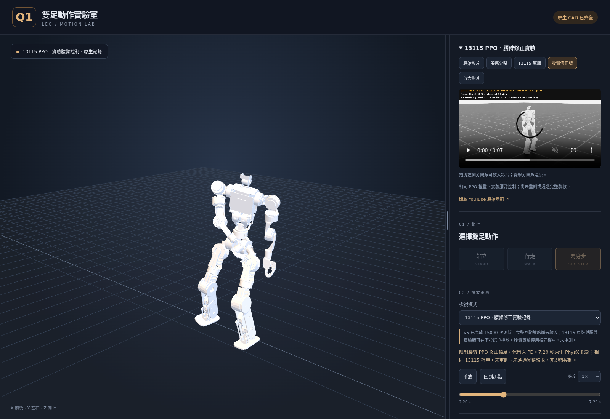

# 13115：腰臂鬆垂與胸口晃動檢查

2026-10-23。這次使用相同的 **13115-update PPO** 做原生 Isaac Sim／PhysX 控制對照，**未執行新 PPO 訓練，未發布正式互動策略**。15,000 次訓練已結束；新實驗仍不能解鎖 WASD／QE。

## 問題與修正

原控制的腿部 implicit PD 為 800／32，腰、肩、肘只有 70／4；腰臂 PPO 修正幅度可達 ±0.35 rad，足以使實際揮手偏離參考與回位姿態。原驗收主要看骨盆直立、腳底與任務指標，沒有直接量胸口；骨盆很直時，腰以上仍可能傾斜近 40°。原 reward 的手臂追蹤項也不能保證完整收回與胸口穩定。

保留的實驗 **`upper_residual_guard`** 限制 PPO 修正幅度：腰 yaw ±0.08、roll ±0.025、pitch ±0.04 rad；肩、肘 ±0.08 rad。**PD 保留原值**，腿部控制函式與目標、原生碰撞、100 Nm／10 rad/s 限制皆不變。未增加根部外力、固定基座或姿態濾波。動作仍由同一份 PPO 配合原生參考目標及物理驅動執行。

直接增加腰臂 PD，或只增加腰部 PD，搭配修正幅度限制時，均出現腳踝接地或提前終止，**不採用**。不是選胸口角度最低的失敗版本當示範。

## 原生對照

三批分別為 seed 42／64 envs、137／128 envs、241／160 envs；每個環境測 20 秒。前兩批各四種控制，第三批五種；每種均平衡包含站立、左閃、右閃、左右連續閃身。這些短回合對照**不是完整操作的獨立 128 回合驗收**。

| 控制版本 | 三批第一回合存活 | 決定 |
|---|---:|---|
| 原設定 | 80／80 | 比較基準 |
| 只改腰臂 PD | 80／80 | 手臂誤差仍大，不選作修正示範 |
| 限制腰臂修正幅度，原 PD | **80／80** | 保留為實驗回放 |
| 腰臂 PD ＋幅度限制 | 72／80 | 拒用；單環境錄影也提前終止 |
| 只改腰部 PD ＋幅度限制 | 28／32 | 拒用 |

以下為相同三批中，原設定與保守版各 **20 個左右連續閃身回合**的平均。胸口以 `center_torso_link` 相對世界直立的傾角與角速度量測；動作窗口 1–6.7 秒，手回位在最後 19–20 秒量測。雙手距離為骨盆座標中的實際手腕對原生參考 FK 的**歐氏距離 RMS**，不是每個座標的 RMS。

| 指標 | 原設定 | 保守版 |
|---|---:|---:|
| 每回合胸口傾角峰值的平均 | 39.03° | **24.23°** |
| 胸口傾角 RMS | 13.57° | 10.89° |
| 胸口角速度 RMS | 1.469 rad/s | **0.842 rad/s** |
| 手臂對參考的關節 RMSE | 0.1318 rad | **0.0513 rad** |
| 回站姿雙手距離 RMS（左／右） | 4.92／3.01 cm | **0.89／0.50 cm** |
| 最後站立速度 | 0.0061 m/s | 0.0175 m/s |

保守版胸口峰值降低約 38%，角速度降低約 43%，手臂誤差降低約 61%。站立速度仍低，但比原設定大。**胸口仍會擺動，這不是穩定性問題已完全解決或已能操作實機的宣告。**

原始逐回合資料：[第一批](results/upper_body_13115_ablation_r2.json)、[第二批](results/upper_body_13115_confirmation_r2_seed137.json)、[第三批](results/upper_body_13115_ablation_r3_waist.json)、[被拒用的 PD＋限制版錄影量測](results/upper_body_13115_record_r2.json)。失敗回合與原因均保留；不將失敗後自動重置的資料列入量測。

## 新錄影與網頁



[GoFile 影片](https://gofile.io/d/XMk2RXxH) · [MP4](results/q1_leg_upper_body_13115_experimental.mp4) · [本片量測與摘要](results/upper_body_13115_record_guard_only.json)。影片為 seed 42、單一環境、7.20 秒／360 幀／50 FPS，左右各閃一次後回站姿，**沒有跌倒、重置或固定機身**，全程標示 `EXPERIMENTAL / NOT ACCEPTED`。

本片胸口峰值 **22.40°**，不是上表 20 回合的平均；雙手回位距離 RMS 為 **0.94／0.50 cm**。逐方向腳底量測：

| 方向與角色 | 實際卸載離地峰值 | 指定擺腿窗口卸載且 ≥2.5 cm 的比例 |
|---|---:|---:|
| 左閃前導腳 | 5.67 cm | 69.2%（9／13） |
| 左閃後隨腳 | 6.02 cm | 91.7%（11／12） |
| 右閃前導腳 | 4.68 cm | 69.2%（9／13） |
| 右閃後隨腳 | 6.68 cm | 100%（12／12） |

右閃前導腳比原片低，因此仍需把上半身與腳步共同驗收。單一好片段不替代整批測試。



```bash
cd ~/projects/q1_leg_urdf
bash start_web.sh
# http://127.0.0.1:8876/web/?source=upper_body
```

若背景 `q1-leg-web` 已啟動，直接開網址即可。下拉選單提供原設定與實驗版 **13115 原生物理記錄**，可旋轉視角、調整時間；右側也能切換原版／修正版影片。記錄包含原生 50 Hz 關節、根部位置與四元數，沒有把胸口晃動抹平；瀏覽器只做影格間插值，不另計算物理，也不啟動 Isaac Sim。

預設仍為 MediaPipe 參考。舊版「PPO 物理評估記錄」使用先前獨立動作模型，**不是 13115 或 15000**。「即時 PPO」的正式控制器仍須通過原有完整驗收；新回放不會繞過此限制，鍵盤與序列按鈕保持停用。

## 重現與後續訓練

```bash
source scripts/isaac_env.sh
"$ISAAC_PYTHON" -u scripts/reinforcement_learning/rsl_rl/ablate_upper_body.py \
  --checkpoint checkpoints/isaac/lift_v5/runs/20261022_0338_recovery20/chunks/0013115_s2_r2/resume.pt \
  --output outputs/new_upper_body_comparison.json --replicates 8 --seed 241 --headless

"$ISAAC_PYTHON" -u scripts/reinforcement_learning/rsl_rl/ablate_upper_body.py \
  --checkpoint checkpoints/isaac/lift_v5/runs/20261022_0338_recovery20/chunks/0013115_s2_r2/resume.pt \
  --output outputs/new_upper_body_record.json --record-variant upper_residual_guard \
  --video outputs/new_upper_body_record.mp4 --headless
```

使用全新輸出路徑。腳踝接觸與提前終止不放寬；錄影遇到失敗即停止，禁止自動重置掩蓋。CPU 測試確認新控制只動腰臂、腿與基準資料保持一致，原生限位仍有效；瀏覽器驗證新來源、時間軸、版本標示及鍵盤鎖定。

若再訓練，應建立**新的控制契約與 run**，保留這次 13115 比較基準，不覆寫已完成的 15,000 次 run。先用低速度／有限閃身訓練胸口相對世界姿態及角速度、腰臂追蹤與回位穩定，維持實際抬腳、卸載接觸及滑動目標；穩定後才恢復 WASD／QE 整合與停止轉換。增加胸口傾角峰值、雙手回位距離與回復速度的獨立驗收，再跑原有完整門檻。不能只增加手臂 reward 而讓策略犧牲腳步，也不能沿用舊 run 的驗收紀錄。本次未啟動這段長時間重訓。
