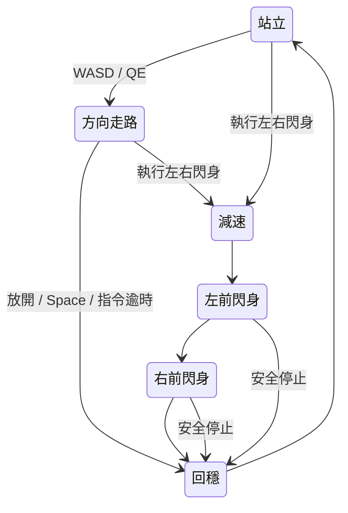

# V4：方向控制、左右閃身與站立銜接

2026-10-21 期限更新：使用者要求台北 09:00 前完成並允許調整規模；本次採 `interactive_v4_deadline.json`，保留 10,240 envs，從 501 次接續、上限 801 次，08:52 停止更新並預留驗收時間。下文 15,000 為原始完整預算；本次實際進度以訓練狀態與評估為準。期限不降低動作門檻。

本版採單一 command / mode / phase conditioned PPO。舊 V3 的固定世界路徑與有限影片模仿不能直接接上 WASD：移動方向、停止與有限動作的中間狀態必須實際參與訓練。分開 PPO 會增加走路到閃身、閃身回站立時的策略交接問題，因此先採統一策略，保留獨立 V4 契約及權重。

## 操作與物理

- W/S：機器人前／後；A/D：機器人左／右平移；Q/E：轉向。
- 持續按鍵以 120 ms 更新指令；放開、失焦或超過 0.5 秒無指令時歸零。Space 可中止序列並進入回穩。
- 「左右閃身各一次」：先減速，再左閃身、右閃身、回穩，最後站立。序列中拒收方向鍵，安全停止仍有效。
- 正常模式轉換、序列結束與停止均不重置關節、根部位置或速度。跌倒後須明確按重新開始才 reset。
- 原生 URDF、關節馬達、IMU 足踝回授與地面接觸產生運動；不施加根部外力、不固定骨盆、不移動世界座標代替步伐。

## 動作來源與 IK

重新觀察 YouTube 前七秒的四次交替展步，見 [逐段觀察](SIDESTEP_V4_MOTION_REVIEW.md)。正面影片中，人體左側為畫面右側。接觸力、前後公尺尺度及精確離地高度無法由單鏡頭確定，不能把 MediaPipe 深度當成實測足底力。

機器人設計目標為：左側動作時右手伸到自身左前、左腳微抬斜前落地，右腳接地承重完成向左前的推進，再低幅抬起回收；右側鏡像。推進需要地面接觸，抬起中的後腳不稱為正在推地。

`config/v4_gaits.json` 提供站立、六種方向走路基底、左右有限閃身，共九個原生軸 bounded IK 模板，每個 61 個相位樣本。它們是 PPO 的關節與足底參考，不是已經驗證的動態策略。腳底高度使用真正 CAD 頂點；步態參考約 4 cm 淨空，速度與限位由 builder 檢查。

PPO 保留 23 actions／110 observations，但輸入語義已改為 V4 方向命令與相位，不能把 V3 權重標為已具備新能力。訓練可用 V3 站立作初始化；正式 V4 播放還須匹配 URDF、gait、joint order、checkpoint 雜湊及 128 回合確認。

## 預算、監控與驗收

本次預算是單一統一策略最多 **10,240 envs × 15,000 iterations**，每 iteration 每 env 24 steps，共最多 **3,686,400,000 transitions**，不是每個模式各額外 15,000 次。

訓練由小幅方向命令逐步增加至完整速度，混合站立、方向移動、左右序列與停止。每段行走長度隨機為 3.5–5.5 秒，中途改變方向、反向或放開按鍵；35% 抽樣使用純 WASD／QE 基底，其餘為連續混合命令。前後模板的平均提供原地踏步，低速縮小水平步幅時仍保留約 4 cm 抬腳；只有接近零速的最後 12% 命令幅度才平滑收回站姿。

獎勵包含速度／偏航跟隨、真腳底淨空、預期接觸、貼地滑動、姿態、手臂參考、動作平滑及接地後腳與向前進度的代理條件。沒有固定世界根部路徑獎勵。

每段保留完整 PPO optimizer 與完成次數，檢查新產出的結果，避免 Kit 把 Python 例外回報成 exit 0。定期以全幅命令、新種子、八類操作作 32 回合驗證，包含走路中轉向及閃身站定後再次前進；連續三次完整通過才進行 128 回合獨立確認。只有確認通過，才發布鍵盤可控權重。

若四次評估的 score 相對進步不足 1% 且仍未達門檻，記錄問題並最多調整兩次 reward：提高足底／速度要求、降低過強的關節模仿束縛、減小學習率；不降低驗收門檻、不把停滯當作成功。總次數仍不超過 15,000。

完整驗收見 [V4_ACCEPTANCE.md](V4_ACCEPTANCE.md)：四方向、停止、轉向、左右前後腳抬腳、斜前落點、手跨身、支撐滑移與最後站立。接觸 load ＋ body 進度僅是推進代理，報告不宣稱已量測分離的切向摩擦力。

確認通過後才錄製 WASD 與有限左右序列、檢查完整回合、轉 GIF、上傳 GoFile、更新 README，最後透過 SSH commit / push。錄製失敗、評估不通過或預算耗盡都不會發布冒充成功的 GIF。
