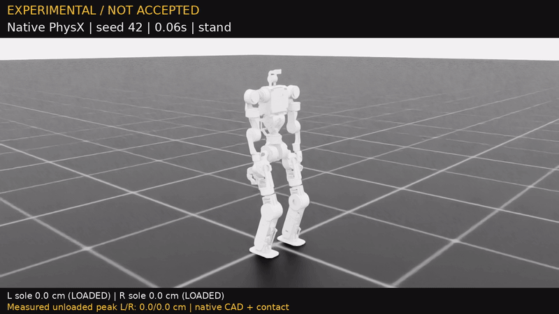

# V6 20,000 次 PPO 最終紀錄

2026-10-25 台灣時間 08:33 已跑完累計 20,000 次，10,240 envs。包含先前 V6 分支已用的 12,800 次，最終分支的 actor 從舊 13115 初始化，並非所有 20,000 次都作用在同一條 actor 演化路徑。使用 Isaac Lab DirectRLEnv + RSL-RL PPO。達上限停止，未通過完整動作驗收。

## 原生影片與 GIF

[GoFile 影片](https://gofile.io/d/74QTLdVi) · [MP4](results/q1_leg_v6_20000_diagnostic.mp4) · [逐幀診斷與實際腳底量測](results/q1_leg_v6_20000_diagnostic.json)



影片 seed 42，137 幀、50 FPS、2.74 秒。預定站立、左右各閃一次後回站；實際在左閃時原生環境觸發 episode 終止，錄影立即停止且不重設，未完成右閃。尚未定位該次終止的精確物理條件，不能僅憑影片斷言原因。GIF 是相同 MP4 的完整轉檔，12 FPS、寬 800 px，不是新模擬或動作補間。

## 終點驗測

[完整 32 回合報告](../checkpoints/isaac/upper_body_v6_20000/evaluation.json)。這是 Stage 0 站立／原地踏步，並非完整閃身或 WASD 驗收。

| 指標 | 終點結果 | 判定 |
|---|---:|---|
| 存活 | 32/32 | 通過目前階段 |
| 下半身門檻 | 全部通過 | 僅限目前階段 |
| 站立左手最末段回位 RMS | 1.94 cm | 超過 1.5 cm |
| 踏步後左／右手最末段回位 RMS | 2.05 / 2.35 cm | 超過 1.5 cm |
| 踏步胸口峰值 | 11.21° | 通過目前階段 |
| 踏步動態胸口 XY 角速度 RMS | 0.655 rad/s | 通過 0.700 上限 |

最後仍在 Stage 0，沒有 Stage 1／2 或獨立 128 回合完整確認；不將這份權重設為網頁正式即時 PPO。近期回位誤差停滯，延長相同設定的訓練不保證改善；下一輪應先檢查手部世界／局部座標回位目標、reward 與動作追蹤的一致性，以及有限閃身的提前終止原因。

## 權重及重現

[latest.pt](../checkpoints/isaac/upper_body_v6_20000/latest.pt) 含完整 PPO checkpoint；[契約](../checkpoints/isaac/upper_body_v6_20000/contract.json)、[訓練來源與計數](../checkpoints/isaac/upper_body_v6_20000/training_result.json)、[發布摘要](../checkpoints/isaac/upper_body_v6_20000/publication.json) 一同保留。

Checkpoint SHA-256：`a87f196047bb58cfbb662cca2a0b27cac0d0317b8fdf9da77285e8f657ba5d8f`。

在目前相同凍結環境與已完成終點狀態下，可用新的輸出檔名重錄：

```bash
source scripts/isaac_env.sh
"$ISAAC_PYTHON" -u scripts/reinforcement_learning/rsl_rl/record_terminal_v6_diagnostic.py \
  --checkpoint checkpoints/isaac/upper_body_v6_20000/latest.pt \
  --video outputs/v6_20000_repeat.mp4 --sequence-only --headless
```

該診斷工具會核對本機終點 supervisor 狀態及凍結來源，因此全新 clone 尚需恢復相應訓練狀態，不能只執行此命令即跳過檢查。權重不具有正式合格契約；正式 player 的安全門檻仍保留。
